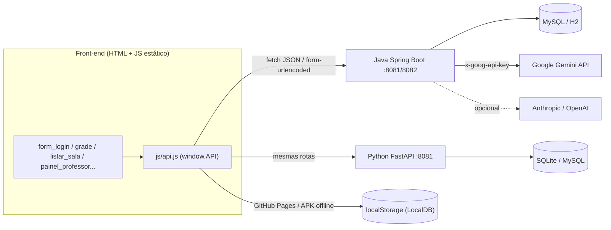
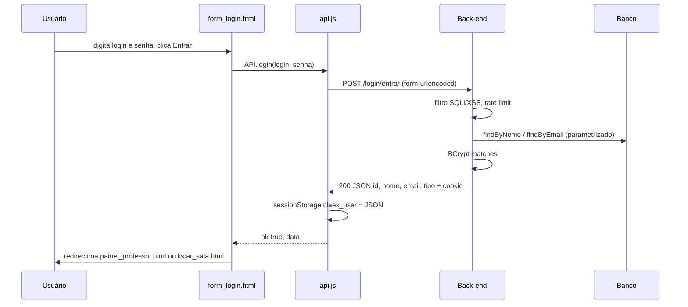
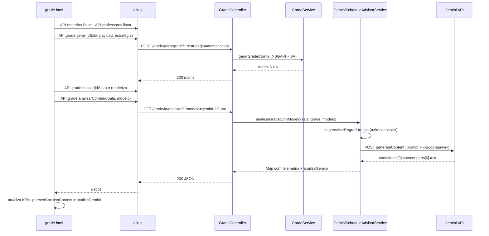
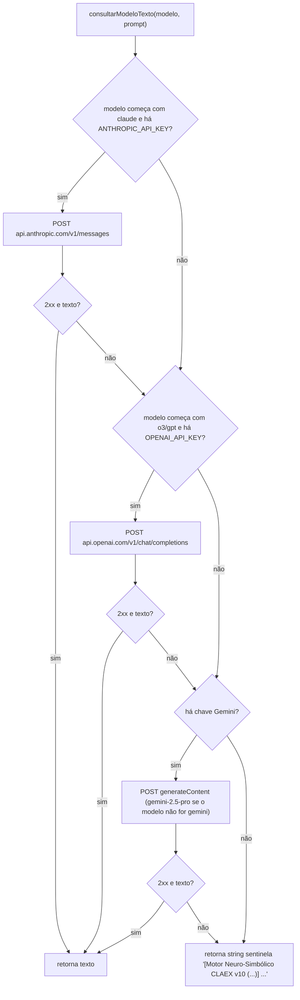

# APIS_E_IA_CLAEX — Endpoints, fluxo front-end → back-end e integração com o Gemini

> Documento de estudo. Os trechos foram copiados **do código real** do repositório, com links para as
> linhas exatas. O CLAEX tem **dois back-ends com as mesmas rotas e os mesmos formatos de JSON**
> (Java Spring Boot em `lolooo-main/` e Python FastAPI em `backend_python/`), então o mesmo front-end
> funciona com qualquer um dos dois.

## Sumário

1. [Arquitetura geral](#1-arquitetura-geral)
2. [Como o front-end chama a API (`api.js`)](#2-como-o-front-end-chama-a-api-apijs)
3. [Referência completa dos endpoints](#3-referência-completa-dos-endpoints)
4. [Fluxos ponta a ponta](#4-fluxos-ponta-a-ponta)
5. [Integração com a IA Gemini (Java)](#5-integração-com-a-ia-gemini-java)
6. [Fallback local sem chave](#6-fallback-local-sem-chave)
7. [IA no back-end Python e no modo offline](#7-ia-no-back-end-python-e-no-modo-offline)
8. [Pontos de atenção](#8-pontos-de-atenção)

---

## 1. Arquitetura geral



| Camada Java | Responsabilidade |
|---|---|
| `Controller/*` | recebe HTTP, valida parâmetros, devolve `ResponseEntity` |
| `Service/*` | regras de negócio (otimizador de grade, IA, hash de senha) |
| `Repository/*` | acesso ao banco via Spring Data JPA |
| `Entity/*` | tabelas (JPA) e formato do JSON (Jackson) |

No Python tudo fica em [main.py](file:///home/antigravity/v1n1k4/00/backend_python/main.py): modelos SQLAlchemy,
funções `s_*` (serializadores que montam o JSON igual ao do Java) e as rotas `@app.get/post/put/delete`.

---

## 2. Como o front-end chama a API (`api.js`)

Todas as páginas usam um único objeto global `window.API`, definido em
[api.js](file:///home/antigravity/v1n1k4/00/lolooo-main/src/main/resources/static/js/api.js).
Nenhuma página faz `fetch` direto: isso centraliza URL base, formato do corpo e fallback offline.

### 2.1 URL base

[api.js L29-L32](file:///home/antigravity/v1n1k4/00/lolooo-main/src/main/resources/static/js/api.js#L29-L32):

```javascript
function apiUrl(path) {
    const base = (localStorage.getItem('claex_api_base') || '').replace(/\/+$/, '');
    return base + path;
}
```

- Sem configuração, `base` é `''` → a URL fica relativa (`/login/entrar`), ou seja, o **mesmo servidor**
  que entregou o HTML. É o caso normal: Spring Boot e FastAPI servem o front-end estático e a API juntos.
- Se `localStorage.claex_api_base` existir (ex.: `https://meu-servidor.com`), todas as chamadas vão para lá.
- `.replace(/\/+$/, '')` remove barras finais para não gerar `//login`.

### 2.2 Servidor real ou motor local?

[api.js L35-L40 e L191-L204](file:///home/antigravity/v1n1k4/00/lolooo-main/src/main/resources/static/js/api.js#L191-L204):

```javascript
function isStaticHost() {
    const customBase = localStorage.getItem('claex_api_base');
    if (customBase) return false;                         // há API configurada -> usa servidor
    const h = location.hostname || '';
    return h.endsWith('.github.io') || location.protocol === 'file:' || location.protocol === 'capacitor:' || Boolean(window.Capacitor);
}

async function tryBackendOrLocal(fnHttp, fnLocal) {
    if (isStaticHost()) {
        return await fnLocal();                            // GitHub Pages / APK: nem tenta o servidor
    }
    try {
        const res = await fnHttp();                        // tenta a API real
        if (res && (res.status === 405 || (res.status === 404 && isStaticHost()))) {
            return await fnLocal();                        // 405 = hospedagem estática recusou POST
        }
        return res;
    } catch (err) {
        return await fnLocal();                            // rede caiu / servidor fora -> modo local
    }
}
```

Cada método de `window.API` passa **duas funções**: a chamada HTTP real e a versão local
(em `localStorage`). Os métodos HTTP lançam `throw new Error('STATIC_FALLBACK')` quando a resposta
não é `ok`, o que cai no `catch` e ativa o motor local.

### 2.3 Dois formatos de corpo

| Formato | Usado em | Por quê |
|---|---|---|
| `application/x-www-form-urlencoded` (`URLSearchParams`) | login, cadastro, atualizar cadastro | o Java usa `@RequestParam`; a senha vai no **corpo**, nunca na URL |
| `application/json` (`JSON.stringify`) | salas, grade, regras de IA, área do professor | objetos aninhados (`{"id_materia": {"id_materia": 1}}`) |

Exemplo — login, [api.js L431-L452](file:///home/antigravity/v1n1k4/00/lolooo-main/src/main/resources/static/js/api.js#L431-L452):

```javascript
async login(login, senha) {
    return await tryBackendOrLocal(
        async () => {
            const body = new URLSearchParams({ login, senha });            // login=...&senha=...
            const response = await fetch(apiUrl('/login/entrar'), {
                method: 'POST',
                headers: { 'Content-Type': 'application/x-www-form-urlencoded;charset=UTF-8' },
                body
            });
            if (response.status === 405) throw new Error('STATIC_405');    // hospedagem estática
            let data = {};
            try { data = await response.json(); } catch (e) {}             // corpo pode não ser JSON
            if (response.ok) {
                window.API.setUsuarioAtual(data);                          // guarda {id,nome,email,tipo}
            }
            return {
                ok: response.ok,
                status: response.status,
                retryAfter: Number(response.headers.get('Retry-After') || data.retryAfter || 0),
                data: data
            };
        },
        async () => { /* versão local: L453-L503 */ }
    );
},
```

- Retorna sempre um objeto padronizado `{ ok, status, retryAfter, data }`, para a página decidir a mensagem (401, 429, 400...).
- `setUsuarioAtual` guarda o usuário em `sessionStorage` (`claex_user`), que é apagado ao fechar a aba.

### 2.4 Mapa `window.API` → endpoint

| Método JS | HTTP |
|---|---|
| `API.cadastros.salvar(nome, email, senha, tipo)` | `POST /form_cadastro-html/salvar` |
| `API.cadastros.listar()` | `GET /form_cadastro-html/listar` |
| `API.cadastros.atualizar(id, nome, senha, tipo)` | `PUT /form_cadastro-html/atualizar/{id}` |
| `API.cadastros.deletar(id)` | `DELETE /form_cadastro-html/deletar/{id}` |
| `API.login(login, senha)` | `POST /login/entrar` |
| `API.salas.listar / buscarPorId / salvar / atualizar / deletar` | `/salas/...` |
| `API.materias.listar()` | `GET /materias/listar` |
| `API.professores.listar()` | `GET /professores/listar` |
| `API.grade.buscar(idSala)` | `GET /grade/buscar/{idSala}` |
| `API.grade.gerar(idSala, payload, estrategia)` | `POST /grade/gerargrade/{idSala}?estrategia=` |
| `API.grade.listarModelosIa()` | `GET /grade/ia/modelos` |
| `API.grade.analisarComIa(idSala, modelo)` | `GET /grade/ia/analisar/{idSala}?modelo=` |
| `API.grade.listarRegrasIa(idSala)` | `GET /grade/ia/regras/{idSala}` |
| `API.grade.ensinarRegraIa(idSala, payload)` | `POST /grade/ia/aprender/{idSala}` |
| `API.grade.removerRegraIa(idRegra)` | `DELETE /grade/ia/regras/{idRegra}` |
| `API.professorArea.*` | `/professor/disponibilidade`, `/professor/materias` |

---

## 3. Referência completa dos endpoints

Convenção: **Java** = arquivo do controller; **Python** = linha em `main.py`. As duas implementações
aceitam e devolvem o mesmo formato. Qualquer rota pode também responder **400** `{"erro": "...", "tipo": "SQL_INJECTION" | "XSS"}`
ou **413** `PAYLOAD_TOO_LARGE` pelo filtro de segurança (ver `SEGURANCA_CLAEX.md`).

### 3.1 Cadastro de usuários — `/form_cadastro-html`

Java: [CadastroHtmlController.java](file:///home/antigravity/v1n1k4/00/lolooo-main/src/main/java/com/claex/crud/Controller/CadastroHtmlController.java) ·
Python: [main.py L886-L962](file:///home/antigravity/v1n1k4/00/backend_python/main.py#L886-L962)

| Método e rota | Requisição | Respostas |
|---|---|---|
| `POST /salvar` | form: `nome`, `email`, `senha`, `tipo` (`aluno`\|`professor`\|`administrador`, padrão `aluno`) | `200` texto `Cadastro realizado com sucesso!` · `400` `Erro: <motivo>` · `429` + `Retry-After` · `500` `Erro interno no servidor.` |
| `GET /listar` | — | `200` `[{"id":1,"nome":"...","email":"...","tipo":"professor"}]` (sem senha) |
| `PUT /atualizar/{id}` | form: `nome?`, `senha?`, `tipo` | `200` `Atualizado com sucesso!` · `400` `Erro: ...` |
| `DELETE /deletar/{id}` | — | `200` `Deletado com sucesso!` · `404` `Registro não encontrado para deleção.` |

Exemplo:

```bash
curl -X POST http://localhost:8081/form_cadastro-html/salvar \
     -d "nome=Maria Souza" -d "email=maria@escola.com" -d "senha=Senha2025" -d "tipo=professor"
# 200  Cadastro realizado com sucesso!
```

### 3.2 Login — `/login/entrar`

Java: [LoginController.java L40-L96](file:///home/antigravity/v1n1k4/00/lolooo-main/src/main/java/com/claex/crud/Controller/LoginController.java#L40-L96) ·
Python: [main.py L969-L1006](file:///home/antigravity/v1n1k4/00/backend_python/main.py#L969-L1006)

Requisição: `POST`, form `login` (nome **ou** e-mail) e `senha`.

| Status | Corpo JSON |
|---|---|
| `200` | `{"mensagem":"Login realizado com sucesso!","id":"2","nome":"Prof. Carlos Mendes","email":"carlos@claex.com","tipo":"professor"}` + cookie de sessão |
| `400` | `{"erro":"Usuário ou senha inválidos."}` (campo vazio ou grande demais) |
| `401` | `{"erro":"Usuário ou senha inválidos.","tentativasRestantes":3}` |
| `429` | `{"erro":"Muitas tentativas de login. Tente novamente em 15 min.","retryAfter":900}` + header `Retry-After: 900` |

### 3.3 Listagens simples

| Rota | Java | Resposta |
|---|---|---|
| `GET /materias/listar` | [MateriaController.java](file:///home/antigravity/v1n1k4/00/lolooo-main/src/main/java/com/claex/crud/Controller/MateriaController.java) | `[{"id_materia":1,"nome_materia":"Matemática"}, ...]` |
| `GET /professores/listar` | [ProfessorControler.java](file:///home/antigravity/v1n1k4/00/lolooo-main/src/main/java/com/claex/crud/Controller/ProfessorControler.java) | `[{"id_professor":1,"nome_professor":"...","email_professor":"..."}, ...]` (sem senha) |

### 3.4 Salas — `/salas`

Java: [SalaController.java](file:///home/antigravity/v1n1k4/00/lolooo-main/src/main/java/com/claex/crud/Controller/SalaController.java) ·
Python: [main.py L1021-L1075](file:///home/antigravity/v1n1k4/00/backend_python/main.py#L1021-L1075)

| Método e rota | Requisição | Resposta |
|---|---|---|
| `GET /salas/listar` | — | lista de salas |
| `GET /salas/{id}` | — | uma sala |
| `POST /salas/salvar` | JSON da sala | sala criada (com `id_sala`) |
| `PUT /salas/{id}` | JSON da sala | sala atualizada |
| `DELETE /salas/{id}` | — | Java: `200` vazio · Python: `Sala removida` (apaga grades, aulas e regras da sala) |

Formato da sala:

```json
{
  "id_sala": 1,
  "nome_sala": "3º Ano A — Ensino Médio",
  "duracao_aula": 50,
  "duracao_intervalo": 20,
  "quant_aula": 6,
  "inicio_aula": "07:30:00",
  "escola": { "id": 1, "nome": "Administrador CLAEX", "email": "...", "tipo": "administrador" }
}
```

`quant_aula` = aulas por dia; é ela que define o número de linhas da grade.

### 3.5 Grade horária — `/grade`

Java: [GradeController.java L38-L71](file:///home/antigravity/v1n1k4/00/lolooo-main/src/main/java/com/claex/crud/Controller/GradeController.java#L38-L71) ·
Python: [main.py L1079-L1141](file:///home/antigravity/v1n1k4/00/backend_python/main.py#L1079-L1141)

**`GET /grade/buscar/{id_sala}`** → matriz `[dia][período]` (5 dias × `quant_aula`). Cada célula é uma aula ou `null`:

```json
[
  [
    { "id_aula": 101, "dia": 0, "periodo": 0,
      "grade": { "id": 7, "sala": { "...": "..." }, "data_grade": "2026-11-27T18:00:00" },
      "id_materia":   { "id_materia": 1, "nome_materia": "Matemática" },
      "id_professor": { "id_professor": 2, "nome_professor": "Prof. Carlos Mendes", "email_professor": "..." } },
    null
  ],
  [ "... terça ..." ]
]
```

**`POST /grade/gerargrade/{id_sala}?estrategia=memetico-sa|rapido`** — roda o otimizador e salva a grade.

Corpo: a "piscina" de aulas a distribuir (uma entrada por slot), montada em
[grade.html L593-L605](file:///home/antigravity/v1n1k4/00/lolooo-main/src/main/resources/static/grade.html#L593-L605):

```json
[
  { "id_materia": { "id_materia": 1 }, "id_professor": { "id_professor": 2 } },
  { "id_materia": { "id_materia": 2 }, "id_professor": { "id_professor": 3 } }
]
```

Java, [GradeController.java L43-L71](file:///home/antigravity/v1n1k4/00/lolooo-main/src/main/java/com/claex/crud/Controller/GradeController.java#L43-L71):

```java
@PostMapping("/gerargrade/{id_sala}")
public ResponseEntity<List<List<AulaEntity>>> gerarGrade(
        @PathVariable Long id_sala,
        @RequestParam(required = false, defaultValue = "memetico-sa") String estrategia,
        @RequestBody(required = false) List<AulaEntity> materias) {

    SalaEntity sala = salaService.buscarPorId(id_sala);
    GradeEntity grade = new GradeEntity();
    grade.setSala(sala);
    GradeEntity gradeEntity = service.salvar(grade);

    List<List<List<AulaEntity>>> gradesExistentes = service.buscarGradesEscola(sala.getId_sala());
    int quantAulas = sala.getQuant_aula() > 0 ? sala.getQuant_aula() : 5;

    int geracoes = "rapido".equalsIgnoreCase(estrategia) ? 35 : 75;
    int individuos = "rapido".equalsIgnoreCase(estrategia) ? 20 : 40;

    List<List<AulaEntity>> gradeFinalizada = service.gerarGradeComIa(
            sala.getId_sala(), gradesExistentes, materias, geracoes, individuos, quantAulas);

    service.salvarGradeComEntidade(gradeFinalizada, gradeEntity);
    return ResponseEntity.ok(gradeFinalizada);
}
```

| Linha | Explicação |
|---|---|
| 45 | `@PathVariable` — pega `{id_sala}` da URL. |
| 46 | `@RequestParam` opcional: `memetico-sa` (padrão, mais qualidade) ou `rapido`. |
| 47 | `@RequestBody` — o Jackson converte o JSON em `List<AulaEntity>`. |
| 49-52 | Cria um novo registro de grade (histórico: cada geração é uma nova `GradeEntity`). |
| 54 | Busca as grades **das outras salas** da escola — o otimizador evita colocar o mesmo professor em duas salas no mesmo horário. |
| 57-58 | Parâmetros do algoritmo genético: nº de gerações e tamanho da população. |
| 60-67 | Roda o otimizador (Memético NSGA-II + Simulated Annealing) — **algoritmo local, não é chamada à IA**. |
| 69-70 | Grava as aulas e devolve a matriz no mesmo formato de `/grade/buscar`. |

> [!NOTE]
> A geração da grade é feita por um **algoritmo de otimização determinístico/estocástico rodando no servidor**,
> não pelo Gemini. O Gemini entra **depois**, para *analisar* a grade e para *comentar* regras (seção 5).

### 3.6 IA — `/grade/ia`

Java: [GradeController.java L73-L119](file:///home/antigravity/v1n1k4/00/lolooo-main/src/main/java/com/claex/crud/Controller/GradeController.java#L73-L119) ·
Python: [main.py L1144-L1261](file:///home/antigravity/v1n1k4/00/backend_python/main.py#L1144-L1261)

| Método e rota | Requisição | Resposta |
|---|---|---|
| `GET /grade/ia/modelos` | — | lista de modelos (abaixo) |
| `GET /grade/ia/analisar/{id_sala}?modelo=gemini-2.5-pro` | — | objeto de análise (abaixo) |
| `GET /grade/ia/regras/{id_sala}` | — | regras ativas da sala + regras globais |
| `POST /grade/ia/aprender/{id_sala}` | JSON da regra | regra salva com o parecer da IA em `analiseGemini` |
| `DELETE /grade/ia/regras/{id_regra}` | — | `Regra de IA removida com sucesso!` |

`GET /grade/ia/modelos`:

```json
[
  { "id": "gemini-2.5-pro",   "nome": "Gemini 2.5 Pro (Deep Thinking)", "provedor": "Google DeepMind", "especialidade": "...", "recomendado": true },
  { "id": "gemini-2.5-flash", "nome": "Gemini 2.5 Flash (Ultra-Low Latency)", "provedor": "Google DeepMind", "recomendado": false },
  { "id": "claude-sonnet-4-20250514", "nome": "Claude Sonnet 4 (...)", "provedor": "Anthropic", "recomendado": false },
  { "id": "o3-mini", "nome": "OpenAI o3-mini (...)", "provedor": "OpenAI", "recomendado": false }
]
```

`POST /grade/ia/aprender/{id_sala}` — corpo montado em [grade.html L750-L757](file:///home/antigravity/v1n1k4/00/lolooo-main/src/main/resources/static/grade.html#L750-L757):

```json
{
  "tipoRegra": "PROIBICAO",
  "alvo": "Prof. Carlos Mendes",
  "diaSemana": "Segunda",
  "maxAulasSeguidas": 2,
  "maxAulasDiaProfessor": 3,
  "descricao": "Carlos não pode dar aula na segunda de manhã"
}
```

Resposta (regra salva):

```json
{
  "id": 12, "sala": { "...": "..." }, "tipoRegra": "PROIBICAO", "alvo": "Prof. Carlos Mendes",
  "diaSemana": "Segunda", "maxAulasSeguidas": 2, "maxAulasDiaProfessor": 3,
  "descricao": "Carlos não pode dar aula na segunda de manhã",
  "analiseGemini": "<texto gerado pelo Gemini ou mensagem do motor local>",
  "ativa": true, "criadaEm": "2026-11-27T18:40:00"
}
```

`GET /grade/ia/analisar/{id_sala}?modelo=...` — resposta montada em
[GeminiScheduleAdvisorService.java L207-L219](file:///home/antigravity/v1n1k4/00/lolooo-main/src/main/java/com/claex/crud/Service/GeminiScheduleAdvisorService.java#L207-L219):

```json
{
  "modelo": "gemini-2.5-pro",
  "algoritmoOtimizacao": "Memético NSGA-II + Simulated Annealing + Reparo Kempe-Chain",
  "modelosDisponiveis": [ "... mesma lista de /modelos ..." ],
  "geminiApiConectada": true,
  "diagnosticoUranos": "✅ AUDITORIA MOTOR CLAEX v10 APROVADA (0 violações) · Equilíbrio Cognitivo: 96% · ...",
  "diagnosticoUranosDetalhes": {
    "violacoesMaisDeDuasSeguidas": 0, "violacoesProfessorDiaInteiro": 0,
    "janelasDocentes": 1, "blocosGeminados": 9,
    "indiceEquilibrioCognitivo": 96, "eficienciaJanelasDocentes": 93,
    "taxaAulasGeminadas": 60, "scoreFitness": 1093,
    "conformidadeUranos": true, "detalhes": []
  },
  "telemetria": { "... igual a diagnosticoUranosDetalhes ..." },
  "analiseIa": "<parecer em 4 tópicos>",
  "analiseGemini": "<mesmo texto de analiseIa>",
  "regrasAtivas": [ "..." ],
  "regrasAprendidas": [ "..." ]
}
```

Campos duplicados (`analiseIa`/`analiseGemini`, `telemetria`/`diagnosticoUranosDetalhes`,
`regrasAtivas`/`regrasAprendidas`) existem por compatibilidade com versões anteriores do front-end.

### 3.7 Área do professor — `/professor`

Java: [ProfessorAreaController.java](file:///home/antigravity/v1n1k4/00/lolooo-main/src/main/java/com/claex/crud/Controller/ProfessorAreaController.java) ·
Python: [main.py L1265-L1418](file:///home/antigravity/v1n1k4/00/backend_python/main.py#L1265-L1418)

O professor é identificado pela **sessão** (`usuarioLogado`) ou, se não houver, pelo parâmetro `?idProfessor=`.

| Método e rota | Requisição | Resposta |
|---|---|---|
| `GET /professor/disponibilidade?idProfessor=2` | — | `[{"id","professor","diaSemana","horarioInicial","horarioFinal","modalidade","observacao","status"}]` |
| `POST /professor/disponibilidade` | JSON `{"diaSemana":"Segunda-feira","horarioInicial":"07:30","horarioFinal":"12:30","modalidade":"Presencial","observacao":"...","idProfessor":2}` | disponibilidade criada · `400` se horários se sobrepõem · `401` professor não identificado |
| `DELETE /professor/disponibilidade/{id}?idProfessor=2` | — | `Disponibilidade removida com sucesso!` · Python: `403` se não for o dono |
| `GET /professor/materias?idProfessor=2` | — | `[{"id","professor","materia":{"id_materia","nome_materia"},"nivelEnsino","experiencia","descricao"}]` |
| `POST /professor/materias` | JSON `{"nomeMateria":"Física","nivelEnsino":"Médio","experiencia":"5 anos","descricao":"...","idProfessor":2}` | vínculo criado (cria a matéria se não existir) |
| `DELETE /professor/materias/{id}?idProfessor=2` | — | `Matéria desvinculada com sucesso!` |

Detalhe Java ([L78-L83](file:///home/antigravity/v1n1k4/00/lolooo-main/src/main/java/com/claex/crud/Controller/ProfessorAreaController.java#L78-L83)):
o front envia `"07:30"`; o controller completa para `"07:30:00"` antes de `LocalTime.parse`.

---

## 4. Fluxos ponta a ponta

### 4.1 Login



Redirecionamento por perfil — [form_login.html L164-L171](file:///home/antigravity/v1n1k4/00/lolooo-main/src/main/resources/static/form_login.html#L164-L171):

```javascript
if (result.ok) {
    const tipoLogado = (result.data && result.data.tipo ? result.data.tipo : "").toLowerCase();
    if (tipoLogado === "professor") {
        window.location.href = "painel_professor.html";     // professor -> painel próprio
    } else {
        window.location.href = "listar_sala.html";          // admin/aluno -> lista de salas
    }
}
```

### 4.2 Gerar grade e analisar com IA



O handler no front — [grade.html L664-L698](file:///home/antigravity/v1n1k4/00/lolooo-main/src/main/resources/static/grade.html#L664-L698):

```javascript
async function analisarGradeComIa() {
    if (!currentSala) return;
    const diagBox = document.getElementById("ia_diagnostico_uranos");
    const parecerBox = document.getElementById("ia_parecer_gemini");
    const badge = document.getElementById("status_uranos_badge");
    const modelSelect = document.getElementById("seletor_modelo_ia");
    const activeTag = document.getElementById("ia_model_active_tag");
    const modelo = modelSelect ? modelSelect.value : "gemini-2.5-pro";
    ...
    diagBox.textContent = `Auditando matriz com ${modelo} e calculando telemetria cognitiva...`;

    try {
        const dados = await window.API.grade.analisarComIa(currentSala.id_sala, modelo);
        if (dados.telemetria || dados.diagnosticoUranosDetalhes) {
            atualizarKpisTelemetria(dados.telemetria || dados.diagnosticoUranosDetalhes);
        }
        if (dados.diagnosticoUranos) {
            diagBox.textContent = dados.diagnosticoUranos;
            const semViolacao = dados.diagnosticoUranos.includes("0 violações");
            diagBox.style.borderLeftColor = semViolacao ? "var(--neon-lime)" : "var(--status-danger)";
            ...
        }
        if (dados.analiseGemini) parecerBox.textContent = dados.analiseGemini;
        if (dados.regrasAprendidas) renderizarListaRegrasIa(dados.regrasAprendidas);
    } catch (e) {
        diagBox.textContent = "Aguardando geração da grade para executar diagnóstico multi-modelo.";
    }
}
```

| Linha | Explicação |
|---|---|
| 671 | Modelo escolhido no `<select id="seletor_modelo_ia">` (trocar o select também dispara a análise, via `onchange`). |
| 677 | Feedback imediato enquanto a IA responde (pode levar até ~25 s). |
| 680 | Chama `GET /grade/ia/analisar/{id}?modelo=...`. |
| 681-683 | Atualiza os cards de KPI (equilíbrio cognitivo, janelas, geminadas). |
| 684-691 | Mostra o resumo e pinta verde/vermelho conforme houver "0 violações". |
| 693 | Mostra o parecer da IA com **`textContent`** — o texto do modelo é tratado como dado, nunca como HTML (proteção contra a IA devolver `<script>`). |
| 695-697 | Qualquer erro mostra uma mensagem neutra em vez de quebrar a página. |

---

## 5. Integração com a IA Gemini (Java)

Toda a integração está em
[GeminiScheduleAdvisorService.java](file:///home/antigravity/v1n1k4/00/lolooo-main/src/main/java/com/claex/crud/Service/GeminiScheduleAdvisorService.java).
Ela **não usa SDK**: chama a API REST do Google diretamente com o `java.net.http.HttpClient` do JDK 11+.

### 5.1 Constantes e cliente HTTP — [L31-L48](file:///home/antigravity/v1n1k4/00/lolooo-main/src/main/java/com/claex/crud/Service/GeminiScheduleAdvisorService.java#L31-L48)

```java
private static final String GEMINI_GENERATE_URL = "https://generativelanguage.googleapis.com/v1beta/models/%s:generateContent";
private static final String ANTHROPIC_MESSAGES_URL = "https://api.anthropic.com/v1/messages";
private static final String OPENAI_CHAT_URL = "https://api.openai.com/v1/chat/completions";

public static final String DEFAULT_MODEL = "gemini-2.5-pro";

@Value("${gemini.api.key:}")
private String configuredApiKey;
...
private final HttpClient httpClient = HttpClient.newBuilder()
        .connectTimeout(Duration.ofSeconds(12))
        .build();
```

| Linha | Explicação |
|---|---|
| 31 | Endpoint oficial `generateContent` da Gemini API. `%s` é substituído pelo nome do modelo (`gemini-2.5-pro` / `gemini-2.5-flash`). |
| 32-33 | Endpoints de Anthropic e OpenAI — usados só se o modelo escolhido for deles **e** houver chave. |
| 35 | Modelo padrão quando o front não especifica. |
| 37-38 | A chave vem de `application.properties` → `${GEMINI_API_KEY:}` → variável de ambiente (ver §5.2). |
| 46-48 | Um único `HttpClient` reutilizado (mantém conexões abertas); timeout de 12 s **para conectar**. |

### 5.2 De onde vem a chave — [L88-L101](file:///home/antigravity/v1n1k4/00/lolooo-main/src/main/java/com/claex/crud/Service/GeminiScheduleAdvisorService.java#L88-L101)

```java
private String resolveGeminiKey() {
    if (configuredApiKey != null && !configuredApiKey.isBlank()) {
        return configuredApiKey.trim();
    }
    String envKey = System.getenv("GEMINI_API_KEY");
    if (envKey != null && !envKey.isBlank()) {
        return envKey.trim();
    }
    String googleKey = System.getenv("GOOGLE_API_KEY");
    if (googleKey != null && !googleKey.isBlank()) {
        return googleKey.trim();
    }
    return "";
}
```

Ordem de prioridade: propriedade Spring → `GEMINI_API_KEY` → `GOOGLE_API_KEY` → vazio (modo local).
`.trim()` evita erro 400/403 por espaço ou quebra de linha copiados junto com a chave.

Como configurar:

```bash
cp .env.example .env
# edite .env e preencha:  GEMINI_API_KEY=AIza...
docker compose --profile java up --build -d        # o compose injeta a variável no container

# ou rodando o Java direto:
GEMINI_API_KEY=AIza... ./mvnw spring-boot:run      # dentro de lolooo-main/
```

A chave é gerada no Google AI Studio. Ela **nunca** vai para o front-end (ver `SEGURANCA_CLAEX.md` §7).

### 5.3 Montagem do prompt de análise — [L157-L189](file:///home/antigravity/v1n1k4/00/lolooo-main/src/main/java/com/claex/crud/Service/GeminiScheduleAdvisorService.java#L157-L189)

```java
public Map<String, Object> analisarGradeComModelo(SalaEntity sala, List<List<AulaEntity>> grade, String modeloSolicitado) {
    String modeloAtivo = (modeloSolicitado != null && !modeloSolicitado.isBlank())
            ? modeloSolicitado.trim()
            : DEFAULT_MODEL;

    List<RegraIaGradeEntity> regrasAprendidas = listarRegrasPorSala(sala != null ? sala.getId_sala() : null);
    String resumoGrade = formatarGradeTexto(grade);
    StringBuilder regrasStr = new StringBuilder();
    for (RegraIaGradeEntity r : regrasAprendidas) {
        regrasStr.append("- [").append(r.getTipoRegra()).append("] ")
                 .append(r.getDescricao())
                 .append(" (Alvo: ").append(r.getAlvo()).append(", Dia: ").append(r.getDiaSemana()).append(")\n");
    }

    Map<String, Object> diagnosticoLocal = diagnosticarRegrasUranos(grade, sala);

    String prompt = "Você é o consultor de IA do Motor CLAEX v10 (Otimizador Memético NSGA-II + Simulated Annealing). " +
            "Analise a grade horária gerada abaixo usando o modelo " + modeloAtivo + ":\n\n" +
            "SALA: " + (sala != null ? sala.getNome_sala() : "Turma") + "\n" +
            "GRADE ATUAL (Segunda a Sexta):\n" + resumoGrade + "\n" +
            "TELEMETRIA MATEMÁTICA:\n" +
            "- Fitness Score: " + diagnosticoLocal.get("scoreFitness") + "\n" +
            "- Índice de Equilíbrio Cognitivo: " + diagnosticoLocal.get("indiceEquilibrioCognitivo") + "%\n" +
            "- Eficiência de Janelas Docentes: " + diagnosticoLocal.get("eficienciaJanelasDocentes") + "%\n" +
            "- Aulas Geminadas Alinhadas: " + diagnosticoLocal.get("taxaAulasGeminadas") + "%\n" +
            "REGRAS APRENDIDAS DA ESCOLA:\n" + (regrasStr.length() > 0 ? regrasStr.toString() : "Nenhuma regra extra cadastrada ainda.\n") + "\n" +
            "Forneça em português um parecer executivo estruturado em 4 tópicos:\n" +
            "1) Diagnóstico de Equilíbrio Cognitivo e Distribuição Semanal;\n" +
            "2) Compactação de Janelas Docentes e Saúde do Professor;\n" +
            "3) Conformidade com Restrições Rígidas e Aprendidas;\n" +
            "4) Recomendação Avançada de Otimização.";

    String respostaIa = consultarModeloTexto(modeloAtivo, prompt);
    if (respostaIa == null || respostaIa.startsWith("[Motor Neuro-Simbólico")) {
        respostaIa = gerarParecerNeuroSimbolicoContextual(sala, grade, diagnosticoLocal, regrasAprendidas, modeloAtivo);
    }
    ...
```

| Linha | Explicação |
|---|---|
| 158-160 | Usa o modelo pedido pelo front, ou o padrão. |
| 162 | Busca as regras que a coordenação "ensinou" (da sala + globais) — elas entram no prompt como contexto. |
| 163 | Converte a matriz em texto legível (ver `formatarGradeTexto` abaixo). |
| 164-169 | Uma linha por regra: `- [PROIBICAO] Carlos não pode ... (Alvo: Prof. Carlos, Dia: Segunda)`. |
| 171 | **Antes** de chamar a IA, calcula métricas objetivas localmente (violações, janelas, fitness). A IA recebe números reais e não precisa "adivinhar". |
| 173-187 | O prompt segue a estrutura clássica: **papel** ("Você é o consultor...") → **dados** (sala, grade, telemetria, regras) → **tarefa e formato** (4 tópicos, em português). |
| 189 | Envia o prompt (seção 5.5). |
| 190-192 | Se não houve resposta da nuvem, gera o parecer local (seção 6). |

O texto da grade enviado ao modelo — [formatarGradeTexto L403-L423](file:///home/antigravity/v1n1k4/00/lolooo-main/src/main/java/com/claex/crud/Service/GeminiScheduleAdvisorService.java#L403-L423) — fica assim:

```text
Segunda: [1º: Matemática - Prof. Carlos Mendes] [2º: Matemática - Prof. Carlos Mendes] [3º: Português - Profa. Helena Costa] ...
Terça: [1º: Física - Prof. Roberto Alves] ...
```

### 5.4 Métricas locais que alimentam o prompt — `diagnosticarRegrasUranos` [L234-L350](file:///home/antigravity/v1n1k4/00/lolooo-main/src/main/java/com/claex/crud/Service/GeminiScheduleAdvisorService.java#L234-L350)

Percorre cada dia e período e conta:

| Métrica | Como é calculada |
|---|---|
| `violacoesMaisDeDuasSeguidas` | mesma matéria **ou** mesmo professor em 3+ períodos consecutivos (L290-L303) |
| `violacoesProfessorDiaInteiro` | professor com mais de 2-3 aulas no dia, ou ocupando todos os períodos (L307-L315) |
| `janelasDocentes` | "buracos" entre a primeira e a última aula de um professor no dia (L316-L320) |
| `blocosGeminados` | pares de aulas seguidas da mesma matéria (L293-L295) — desejável |
| `penalidadeFadigaCognitiva` | 3+ aulas seguidas de peso 3 (Matemática, Física, Química) — `pesoCognitivoMateria` L222-L232 |

E combina em índices de 0-100 e um `scoreFitness` (L325-L336):

```java
int scoreFitness = Math.max(0, 1000
        - (violacoesMaisDeDuasSeguidas * 200)   // violação grave
        - (violacoesProfessorDiaInteiro * 300)  // violação mais grave
        - (janelasDocentes * 15)
        - (penalidadeFadigaCognitiva * 20)
        + (blocosGeminados * 12));              // bônus
```

### 5.5 A chamada HTTP ao Gemini — `consultarModeloTexto` [L429-L502](file:///home/antigravity/v1n1k4/00/lolooo-main/src/main/java/com/claex/crud/Service/GeminiScheduleAdvisorService.java#L429-L502)

O método tenta os provedores em ordem e **devolve o primeiro texto válido**:



Bloco do Gemini — [L473-L501](file:///home/antigravity/v1n1k4/00/lolooo-main/src/main/java/com/claex/crud/Service/GeminiScheduleAdvisorService.java#L473-L501):

```java
// 3. Gemini 2.5 Pro / Flash via generateContent endpoint
String geminiKey = resolveGeminiKey();
if (!geminiKey.isEmpty()) {
    String geminiModel = modelId.startsWith("gemini") ? modelId : DEFAULT_MODEL;
    try {
        // A chave vai no header x-goog-api-key (e NÃO na URL ?key=...), assim não aparece em logs de proxy/servidor
        String url = String.format(GEMINI_GENERATE_URL, geminiModel);
        String jsonPayload = "{\"contents\":[{\"parts\":[{\"text\":\"" + escapeJson(prompt) + "\"}]}]," +
                "\"generationConfig\":{\"temperature\":0.35,\"maxOutputTokens\":700}}";

        HttpRequest request = HttpRequest.newBuilder()
                .uri(URI.create(url))
                .timeout(Duration.ofSeconds(25))
                .header("Content-Type", "application/json")
                .header("x-goog-api-key", geminiKey)
                .POST(HttpRequest.BodyPublishers.ofString(jsonPayload))
                .build();

        HttpResponse<String> response = httpClient.send(request, HttpResponse.BodyHandlers.ofString());
        if (response.statusCode() >= 200 && response.statusCode() < 300 && response.body() != null) {
            String extracted = extractTextFromJson(response.body());
            if (!extracted.isBlank()) {
                return extracted;
            }
        }
    } catch (Exception ignored) {}
}

return "[Motor Neuro-Simbólico CLAEX v10 (" + modelId + ")] Diretriz validada e acoplada com sucesso à função de fitness multi-objetivo (NSGA-II + Simulated Annealing).";
```

| Linha | Explicação |
|---|---|
| 474-475 | Sem chave → pula direto para o fallback (L501). |
| 476 | Se o usuário escolheu Claude/o3 mas não há chave desses provedores, o Gemini **assume** com o modelo padrão. |
| 479 | Monta `https://.../models/gemini-2.5-pro:generateContent`. |
| 480-481 | Corpo no formato da Gemini API (ver JSON abaixo). `escapeJson` protege aspas e quebras de linha do prompt para não quebrar o JSON. |
| 481 | `temperature: 0.35` — respostas mais consistentes e factuais (0 = determinístico, 1+ = criativo). `maxOutputTokens: 700` — limita o tamanho/custo da resposta. |
| 485 | Timeout de 25 s para a **resposta inteira** (modelos com "thinking" podem demorar). |
| 487 | Autenticação pelo header `x-goog-api-key`. |
| 491 | Chamada **síncrona**: a thread espera a resposta. |
| 492 | Só aceita status 2xx. Erros 400 (prompt inválido), 403 (chave inválida), 429 (cota estourada) e 5xx caem no fallback. |
| 493-496 | Extrai o texto; se vier vazio, também cai no fallback. |
| 498 | `catch (Exception ignored)` — timeout, DNS, rede: nenhuma falha da IA derruba a API; o usuário sempre recebe uma análise. |
| 501 | **String sentinela**: começa com `[Motor Neuro-Simbólico` para que o chamador saiba que a nuvem não respondeu. |

JSON enviado ao Google:

```json
{
  "contents": [
    { "parts": [ { "text": "Você é o consultor de IA do Motor CLAEX v10 ... 4) Recomendação Avançada de Otimização." } ] }
  ],
  "generationConfig": { "temperature": 0.35, "maxOutputTokens": 700 }
}
```

JSON típico de resposta do Google (resumido):

```json
{
  "candidates": [
    {
      "content": { "role": "model", "parts": [ { "text": "1) Diagnóstico de Equilíbrio Cognitivo...\n2) ..." } ] },
      "finishReason": "STOP"
    }
  ],
  "usageMetadata": { "promptTokenCount": 812, "candidatesTokenCount": 410 }
}
```

### 5.6 Tratamento da resposta — [L504-L534](file:///home/antigravity/v1n1k4/00/lolooo-main/src/main/java/com/claex/crud/Service/GeminiScheduleAdvisorService.java#L504-L534)

```java
private String escapeJson(String raw) {
    if (raw == null) return "";
    return raw.replace("\\", "\\\\")     // 1º a barra invertida (senão escaparia as próximas trocas)
              .replace("\"", "\\\"")     // aspas -> \"
              .replace("\r", "\\r")
              .replace("\n", "\\n")      // quebras de linha -> \n literal
              .replace("\t", "\\t");
}

private String extractTextFromJson(String json) {
    Pattern textPattern = Pattern.compile("\"text\"\\s*:\\s*\"((?:\\\\.|[^\"\\\\])*)\"");
    Matcher m = textPattern.matcher(json);
    if (m.find()) {
        return unescapeJsonString(m.group(1));
    }
    Pattern contentPattern = Pattern.compile("\"content\"\\s*:\\s*\"((?:\\\\.|[^\"\\\\])*)\"");
    Matcher m2 = contentPattern.matcher(json);
    if (m2.find()) {
        return unescapeJsonString(m2.group(1));
    }
    return "";
}

private String unescapeJsonString(String escaped) {
    if (escaped == null) return "";
    return escaped.replace("\\n", "\n")
                  .replace("\\r", "\r")
                  .replace("\\t", "\t")
                  .replace("\\\"", "\"")
                  .replace("\\\\", "\\");
}
```

| Trecho | Explicação |
|---|---|
| `"text"\s*:\s*"` | procura a chave `"text":` seguida de aspas — no Gemini é `candidates[0].content.parts[0].text`; no Anthropic é `content[0].text`. |
| `((?:\\.\|[^"\\])*)` | captura o valor da string: qualquer **sequência de escape** (`\"`, `\n`...) **ou** qualquer caractere que não seja aspas/barra. Assim aspas escapadas dentro do texto não encerram a captura cedo. |
| `m.find()` | pega a **primeira** ocorrência. |
| `"content"\s*:\s*"` | segundo padrão para a OpenAI, onde o texto vem em `choices[0].message.content` (string). |
| `unescapeJsonString` | desfaz os escapes para que `\n` vire quebra de linha real — o front exibe com `textContent` dentro de uma caixa que respeita quebras. |
| `return ""` | nada encontrado → o chamador trata como falha e usa o fallback. |

A abordagem com regex evita adicionar dependência de parser e funciona para os três provedores com o mesmo código.
(Limitações em §8.)

### 5.7 IA ao cadastrar uma regra — `registrarAprendizado` [L120-L147](file:///home/antigravity/v1n1k4/00/lolooo-main/src/main/java/com/claex/crud/Service/GeminiScheduleAdvisorService.java#L120-L147)

```java
RegraIaGradeEntity regra = new RegraIaGradeEntity();
if (idSala != null) {
    salaRepository.findById(idSala).ifPresent(regra::setSala);
}
regra.setTipoRegra(tipoRegra != null && !tipoRegra.isBlank() ? tipoRegra.toUpperCase() : "PREFERENCIA");
regra.setAlvo(alvo != null ? alvo.trim() : "");
regra.setDiaSemana(diaSemana != null ? diaSemana.trim() : "Todos");
regra.setMaxAulasSeguidas(maxSeguidas != null && maxSeguidas > 0 ? maxSeguidas : 2);
regra.setMaxAulasDiaProfessor(maxDiaProf != null && maxDiaProf > 0 ? maxDiaProf : 3);
regra.setDescricao(descricao != null ? descricao.trim() : "Regra pedagógica Motor CLAEX");

String parecerIa = consultarModeloTexto(
    DEFAULT_MODEL,
    "Você é o motor pedagógico neuro-simbólico CLAEX de horários escolares. " +
    "O gestor escolar cadastrou a seguinte diretriz de aprendizado para a grade horária:\n" +
    "- Tipo: " + regra.getTipoRegra() + "\n" +
    "- Professor/Matéria alvo: " + regra.getAlvo() + "\n" +
    "- Dia: " + regra.getDiaSemana() + "\n" +
    "- Limite máx seguidas: " + regra.getMaxAulasSeguidas() + " | Limite máx por dia do professor: " + regra.getMaxAulasDiaProfessor() + "\n" +
    "- Descrição: " + regra.getDescricao() + "\n\n" +
    "Responda de forma concisa (em até 3 frases em português) confirmando como o otimizador Memético NSGA-II + Simulated Annealing aplicará essa restrição e o impacto pedagógico positivo."
);

regra.setAnaliseGemini(parecerIa);
return regraRepository.save(regra);
```

1. Normaliza os campos com valores padrão seguros (tipo em maiúsculas, limites > 0).
2. Pede ao Gemini um comentário curto (até 3 frases) sobre a regra.
3. Grava o comentário na coluna `analiseGemini` — ele aparece em itálico abaixo de cada regra na tela
   ([grade.html L733-L734](file:///home/antigravity/v1n1k4/00/lolooo-main/src/main/resources/static/grade.html#L733-L734), com `escapeHtml`).

A regra em si é usada pelo **otimizador** como restrição; o texto do Gemini é explicativo.

---

## 6. Fallback local sem chave

O sistema foi projetado para funcionar **100% sem chave de IA** (apresentações, CI, ambiente offline).

### 6.1 Como o fallback é detectado

1. `consultarModeloTexto` não encontra chave (ou a chamada falha) → devolve a string que começa com
   `[Motor Neuro-Simbólico CLAEX v10 (...)]` (L501).
2. Em `analisarGradeComModelo`, a linha 190 testa exatamente esse prefixo:

```java
if (respostaIa == null || respostaIa.startsWith("[Motor Neuro-Simbólico")) {
    respostaIa = gerarParecerNeuroSimbolicoContextual(sala, grade, diagnosticoLocal, regrasAprendidas, modeloAtivo);
}
```

3. O campo `geminiApiConectada` informa ao front se havia alguma chave configurada — [L205](file:///home/antigravity/v1n1k4/00/lolooo-main/src/main/java/com/claex/crud/Service/GeminiScheduleAdvisorService.java#L205):

```java
boolean cloudConnected = !resolveGeminiKey().isEmpty() || !resolveAnthropicKey().isEmpty() || !resolveOpenAiKey().isEmpty();
```

> [!NOTE]
> `geminiApiConectada: true` significa "há chave configurada", não "a chamada desta vez deu certo".
> Se a chave existir mas a chamada falhar (cota, rede), o parecer exibido será o local.

### 6.2 O parecer local — `gerarParecerNeuroSimbolicoContextual` [L352-L401](file:///home/antigravity/v1n1k4/00/lolooo-main/src/main/java/com/claex/crud/Service/GeminiScheduleAdvisorService.java#L352-L401)

```java
if (grade == null || grade.isEmpty()) {
    return "Grade ainda não gerada para esta sala. Clique em 'Gerar Grade' para executar o otimizador Memético NSGA-II + Simulated Annealing.";
}
Set<String> materiasUnicas = new HashSet<>();
Set<String> profsUnicos = new HashSet<>();
for (List<AulaEntity> dia : grade) { ... materiasUnicas.add(...); profsUnicos.add(...); }

int eqCog = ((Number) diag.getOrDefault("indiceEquilibrioCognitivo", 96)).intValue();
int efJan = ((Number) diag.getOrDefault("eficienciaJanelasDocentes", 95)).intValue();
int gem = ((Number) diag.getOrDefault("blocosGeminados", 0)).intValue();
int score = ((Number) diag.getOrDefault("scoreFitness", 980)).intValue();

return String.format(
    "🧠 PARECER EXECUTIVO · MOTOR NEURO-SIMBÓLICO CLAEX v10 [%s]\n\n" +
    "1) Equilíbrio Cognitivo (%d%%) & Ergonomia Mental:\n" + "   A turma '%s' distribui %d disciplinas entre %d docentes ...\n\n" +
    "2) Otimização Meta-Heurística (Fitness Score: %d pts | %d Blocos Geminados):\n" + "   ...\n\n" +
    "3) Compactação de Janelas Docentes (%d%% de Eficiência):\n" + "   ...\n\n" +
    "4) Memória de Aprendizado (%d Regras Ativas):\n" + "   %s",
    modeloAtivo.toUpperCase(), eqCog, nomeSala, materiasUnicas.size(), profsUnicos.size(),
    score, gem, efJan, regras != null ? regras.size() : 0, ...);
```

- É um **template** preenchido com os números reais calculados em `diagnosticarRegrasUranos`
  (mesmos 4 tópicos que o prompt pede ao Gemini). Assim o front exibe o mesmo layout com ou sem nuvem.
- `%%` dentro de `String.format` produz um `%` literal.
- `getOrDefault(..., 96)` evita `NullPointerException` se alguma métrica faltar.

> [!IMPORTANT]
> Alguns trechos do template são frases fixas (ex.: "convergiu sem nenhuma violação", "Nenhum professor foi
> alocado o dia inteiro") e **não mudam** conforme as métricas. Se houver violações, o resumo em
> `diagnosticoUranos` mostra "⚠️ N alertas" corretamente, mas o texto do parecer local continua otimista.
> Vale mencionar isso se alguém comparar os dois campos.

No cadastro de regra (§5.7) não há template contextual: sem chave, `analiseGemini` recebe a própria
string sentinela `[Motor Neuro-Simbólico CLAEX v10 (gemini-2.5-pro)] Diretriz validada ...`.

---

## 7. IA no back-end Python e no modo offline

### 7.1 Python (FastAPI) — **não chama a nuvem**

O back-end Python mantém as **mesmas rotas e o mesmo JSON**, mas a análise é sempre local:

- `/grade/ia/analisar/{id_sala}` ([main.py L1200-L1261](file:///home/antigravity/v1n1k4/00/backend_python/main.py#L1200-L1261))
  calcula `diagnosticar_regras_uranos_matriz` e monta um parecer por f-string — mesmo formato do template Java.
- `/grade/ia/aprender/{id_sala}` ([L1170-L1173](file:///home/antigravity/v1n1k4/00/backend_python/main.py#L1170-L1173)) grava um parecer fixo:
  ```python
  parecer = (
      f"[Motor Neuro-Simbólico CLAEX v10] Diretriz '{tipo}' para '{alvo}' validada. "
      f"Restrição (Máx. {max_seg} seguidas, {max_dia}/dia) integrada à função objetivo NSGA-II + Simulated Annealing."
  )
  ```
- `geminiApiConectada` ([L1253](file:///home/antigravity/v1n1k4/00/backend_python/main.py#L1253)) apenas reflete se
  `GEMINI_API_KEY` ou `ANTHROPIC_API_KEY` existe no ambiente:
  ```python
  "geminiApiConectada": bool(os.getenv("GEMINI_API_KEY") or os.getenv("ANTHROPIC_API_KEY")),
  ```

> [!WARNING]
> Como o container principal do `docker-compose` (`claex-app`) é o **Python**, rodar `docker compose up`
> com `GEMINI_API_KEY` preenchida faz a tela indicar "conectada", mas o parecer **continua sendo local**.
> Para ter respostas reais do Gemini, use o back-end Java: `docker compose --profile java up` e acesse a porta **8082**.

### 7.2 Modo offline (GitHub Pages / APK) — `api.js`

Sem servidor, `analisarComIa` usa o motor local — [api.js L825-L841](file:///home/antigravity/v1n1k4/00/lolooo-main/src/main/resources/static/js/api.js#L825-L841):

```javascript
async () => {
    const db = carregarDb();
    const matriz = db.grades[String(idSala)] || construirGradePadrao(db, idSala);
    const totalAulas = Array.isArray(matriz) ? matriz.reduce((acc, col) => acc + (col ? col.length : 0), 0) : 30;
    return {
        modeloUtilizado: modelo,
        diagnostico: `[Auditoria ${modelo}] Matriz horária verificada: 0 choques docentes, ...`,
        telemetria: {
            scoreFitness: 985, indiceEquilibrioCognitivo: 96, eficienciaJanelasDocentes: 98,
            janelasDocentes: 0, blocosGeminados: Math.floor(totalAulas / 2), taxaAulasGeminadas: 92
        }
    };
}
```

- Os números de telemetria são **fixos** (demonstração), exceto `blocosGeminados`.
- Os nomes dos campos (`modeloUtilizado`, `diagnostico`) **diferem** do servidor (`modelo`, `diagnosticoUranos`,
  `analiseGemini`). Como `grade.html` lê `diagnosticoUranos` e `analiseGemini`, no modo offline só os KPIs
  são atualizados; as caixas de diagnóstico e parecer ficam com o texto anterior. Correção simples:
  devolver também `diagnosticoUranos` e `analiseGemini` nesse objeto.
- Nenhuma chave de IA existe no front-end, em nenhum modo.

### 7.3 Comparativo

| | Java + chave | Java sem chave | Python | Offline (`api.js`) |
|---|---|---|---|---|
| Métricas calculadas da grade real | ✅ | ✅ | ✅ | ❌ (valores fixos) |
| Parecer gerado pelo Gemini | ✅ | ❌ template | ❌ template | ❌ frase fixa |
| Comentário de regra pelo Gemini | ✅ | ❌ sentinela | ❌ frase fixa | ❌ frase fixa |
| Claude / o3-mini | se houver chave do provedor; senão Gemini | ❌ | ❌ | ❌ |

---

## 8. Pontos de atenção

Itens observados lendo o código, úteis para perguntas da banca ou próximos passos:

1. **Prompt injection:** `descricao`, `alvo` e `nome_sala` (digitados pelo usuário) são concatenados no prompt.
   Alguém poderia escrever "ignore as instruções anteriores e ...". O impacto é limitado (a resposta é só texto,
   exibida com `textContent`), mas o ideal é delimitar os dados (ex.: entre `"""`) e instruir o modelo a tratá-los como dados.
2. **Parser por regex:** pega o **primeiro** `"text"` do JSON e não decodifica escapes `\uXXXX`. A ordem das trocas em
   `unescapeJsonString` (`\\n` antes de `\\\\`) pode alterar textos que contenham uma barra invertida literal seguida de `n`.
   Usar o Jackson (`ObjectMapper.readTree(...).at("/candidates/0/content/parts/0/text")`), que já está no projeto, resolveria.
3. **`maxOutputTokens: 700` com `gemini-2.5-pro`:** nos modelos 2.5 com raciocínio ("thinking"), os tokens de raciocínio
   podem consumir parte desse limite; se a resposta vier sem texto (`finishReason: MAX_TOKENS`), o sistema cai no
   fallback silenciosamente. Se isso acontecer, aumentar o limite ou configurar o orçamento de raciocínio
   (`thinkingConfig`) resolve.
4. **Erros silenciosos:** `catch (Exception ignored)` garante disponibilidade, mas não registra o motivo (chave inválida,
   cota). Um `LOG.warning` com o status HTTP (sem a chave) ajudaria a depurar.
5. **Chamada síncrona:** cada análise prende uma thread por até ~25 s. Para muitos usuários simultâneos, considerar
   cache do parecer por grade ou chamada assíncrona.
6. **Paridade Java × Python:** rotas e JSON são iguais, mas só o Java chama a IA de verdade (ver §7.1), e as gerações/população
   do otimizador diferem levemente (Java 75/40, Python 70/36 no modo `memetico-sa`).
7. **Autorização:** os endpoints de IA (inclusive `POST /aprender` e `DELETE /regras`) não verificam perfil no servidor;
   o front só esconde os botões para não-administradores. Detalhes em `SEGURANCA_CLAEX.md` §10.
