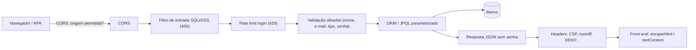
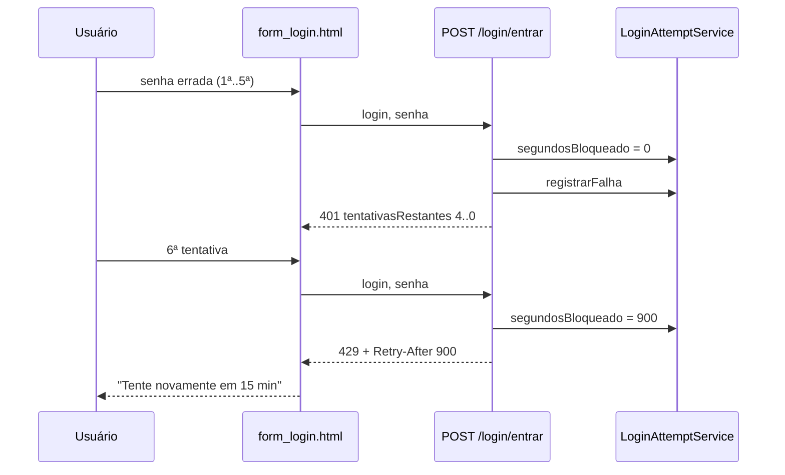
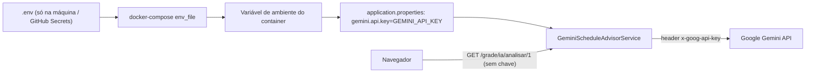

# SEGURANÇA_CLAEX — Camadas de segurança explicadas linha a linha

> Documento de estudo. Todos os trechos abaixo foram copiados **do código real** do repositório
> (Java Spring Boot em `lolooo-main/`, Python FastAPI em `backend_python/`, front-end em
> `lolooo-main/src/main/resources/static/`). Os números de linha batem com os arquivos atuais.

## Sumário

0. [Visão geral — defesa em profundidade](#0-visão-geral--defesa-em-profundidade)
1. [SQL Injection](#1-sql-injection)
2. [XSS / JavaScript Injection](#2-xss--javascript-injection)
3. [Força-bruta no login (rate limit)](#3-força-bruta-no-login-rate-limit)
4. [Senhas (hash) e respostas que não vazam dados](#4-senhas-hash-e-respostas-que-não-vazam-dados)
5. [Headers HTTP de segurança](#5-headers-http-de-segurança)
6. [CORS](#6-cors)
7. [Ocultação das API keys e do `.env`](#7-ocultação-das-api-keys-e-do-env)
8. [Docker e CI (camadas de infraestrutura)](#8-docker-e-ci-camadas-de-infraestrutura)
9. [Como testar cada camada](#9-como-testar-cada-camada)
10. [Limitações conhecidas (seja honesto na apresentação)](#10-limitações-conhecidas-seja-honesto-na-apresentação)

---

## 0. Visão geral — defesa em profundidade

Uma requisição percorre várias barreiras. Se uma falhar, a próxima ainda protege.



| Camada | Java (Spring Boot) | Python (FastAPI) | Front-end offline (`api.js`) |
|---|---|---|---|
| SQLi — consulta parametrizada | Spring Data JPA / `@Query` com `:param` | SQLAlchemy `filter_by` | — (não há SQL) |
| SQLi/XSS — filtro de entrada | `InputSanitizationFilter` + `InputThreatDetector` | `SecurityMiddleware` + `detectar_ameaca` | `detectarAmeaca()` |
| XSS — saída | CSP + `escapeHtml`/`textContent` no front | CSP | `escapeHtml()` |
| Força-bruta | `LoginAttemptService` | `LoginAttemptLimiter` | contador em `localStorage` |
| Senhas | BCrypt custo 12 | PBKDF2-SHA256 310 mil iterações | hash local não-criptográfico (ver §10) |
| Headers | `SecurityConfig` | `SECURITY_HEADERS` | — |
| CORS | `CorsConfig` | `CORSMiddleware` | — |
| Segredos | `${GEMINI_API_KEY:}` + `.env` | `os.getenv` + `.env` | nenhuma chave no front |

---

## 1. SQL Injection

**O ataque:** o usuário digita algo como `admin' OR '1'='1` no login. Se o back-end montasse o SQL
concatenando strings (`"SELECT * FROM usuarios WHERE nome = '" + login + "'"`), a condição
`'1'='1'` seria sempre verdadeira e o atacante entraria sem senha.

O CLAEX usa **duas camadas**: (1.1) consultas parametrizadas — a proteção principal — e
(1.2) um filtro que barra cedo os payloads óbvios e registra log.

### 1.1 Camada principal: consultas parametrizadas

#### Java — Spring Data JPA

[CadastroRepository.java](file:///home/antigravity/v1n1k4/00/lolooo-main/src/main/java/com/claex/crud/Repository/CadastroRepository.java)

```java
Optional<CadastroEntity> findByNome(String nome);
Optional<CadastroEntity> findByEmail(String email);
```

- O Spring **gera** a consulta a partir do nome do método: `SELECT ... WHERE nome = ?`.
- O `?` é um *bind parameter*: o valor digitado vai para o banco **separado** do comando SQL,
  pelo driver JDBC (`PreparedStatement`). O banco nunca interpreta o conteúdo como SQL; `' OR '1'='1`
  vira apenas um nome de usuário estranho que não existe.

Quando há JPQL escrita à mão, ela também usa parâmetros nomeados — por exemplo em
[MateriaRepository.java](file:///home/antigravity/v1n1k4/00/lolooo-main/src/main/java/com/claex/crud/Repository/MateriaRepository.java#L13-L14):

```java
@Query("SELECT m FROM MateriaEntity m WHERE LOWER(m.nome_materia) = LOWER(:nome)")
Optional<MateriaEntity> findByNomeMateriaIgnoreCase(@Param("nome") String nome);
```

| Trecho | Significado |
|---|---|
| `:nome` | marcador de parâmetro — **não** é concatenação |
| `@Param("nome") String nome` | liga o argumento Java ao marcador; o Hibernate envia como bind |

Uso no login — [LoginController.java L63-L65](file:///home/antigravity/v1n1k4/00/lolooo-main/src/main/java/com/claex/crud/Controller/LoginController.java#L63-L65):

```java
// 2) Busca via Spring Data JPA (consulta parametrizada -> imune a SQL Injection)
Optional<CadastroEntity> usuarioOpt = repository.findByNome(login.trim())
        .or(() -> repository.findByEmail(login.trim()));
```

- Linha 64: procura pelo **nome**; `.trim()` remove espaços nas pontas.
- Linha 65: `.or(...)` só executa a segunda consulta (por **e-mail**) se a primeira não achou nada.

#### Python — SQLAlchemy ORM

[main.py L986-L987](file:///home/antigravity/v1n1k4/00/backend_python/main.py#L986-L987):

```python
# 2) consulta parametrizada via ORM
u = db.query(Cadastro).filter_by(nome=login).first() or db.query(Cadastro).filter_by(email=login).first()
```

- `filter_by(nome=login)` gera `WHERE tbl_cadastro.nome = ?` e passa `login` como parâmetro.
- `.first()` devolve o primeiro resultado ou `None`; o `or` tenta por e-mail se não achou por nome.

Nenhum ponto do código monta SQL com f-string ou `+`, então mesmo que o filtro de entrada
deixasse algo passar, o banco continuaria protegido.

### 1.2 Camada extra: detector de padrões maliciosos

[InputThreatDetector.java L18-L29](file:///home/antigravity/v1n1k4/00/lolooo-main/src/main/java/com/claex/crud/security/InputThreatDetector.java#L18-L29):

```java
/** Assinaturas clássicas de SQL Injection. */
private static final Pattern SQLI = Pattern.compile(
        "(?i)("
        + "\\bunion\\b\\s+(all\\s+)?\\bselect\\b"           // UNION SELECT
        + "|'\\s*(or|and)\\s+'?[\\w]+'?\\s*=\\s*'?[\\w]+"     // ' OR '1'='1
        + "|'\\s*(or|and)\\s+\\d+\\s*=\\s*\\d+"               // ' OR 1=1
        + "|'\\s*;?\\s*--"                                  // '--  (comentário)
        + "|;\\s*(drop|delete|insert|update|alter|truncate|create|exec)\\b" // empilhamento
        + "|\\b(sleep|benchmark|pg_sleep|waitfor\\s+delay)\\s*\\(" // time-based blind
        + "|\\binformation_schema\\b|\\bxp_cmdshell\\b"
        + "|/\\*.*\\*/"                                     // comentário inline
        + ")");
```

| Linha | Padrão | Ataque que detecta |
|---|---|---|
| 20 | `(?i)` | torna tudo *case-insensitive* (`UNION`, `union`, `UnIoN`) |
| 21 | `\bunion\b\s+(all\s+)?\bselect\b` | `UNION SELECT` / `UNION ALL SELECT` — juntar dados de outra tabela |
| 22 | `'\s*(or\|and)\s+'?\w+'?\s*=\s*'?\w+` | `' OR 'a'='a` — fechar a aspa e criar condição sempre verdadeira |
| 23 | `'\s*(or\|and)\s+\d+\s*=\s*\d+` | `' OR 1=1` — mesma ideia com números |
| 24 | `'\s*;?\s*--` | `admin'--` — fechar a aspa e comentar o resto da consulta (ignora a senha) |
| 25 | `;\s*(drop\|delete\|...)\b` | `; DROP TABLE` — *stacked queries* (empilhar outro comando) |
| 26 | `(sleep\|benchmark\|pg_sleep\|waitfor delay)\s*\(` | *time-based blind*: o atacante mede o tempo de resposta |
| 27 | `information_schema`, `xp_cmdshell` | listar tabelas do banco / executar comandos no SQL Server |
| 28 | `/\*.*\*/` | comentário inline usado para driblar filtros (`UN/**/ION`) |

O método que aplica os padrões — [L41-L46](file:///home/antigravity/v1n1k4/00/lolooo-main/src/main/java/com/claex/crud/security/InputThreatDetector.java#L41-L46):

```java
public static String detectar(String valor) {
    if (valor == null || valor.isEmpty()) return null;   // nada para analisar
    if (SQLI.matcher(valor).find()) return "SQL_INJECTION"; // find() = procura em qualquer posição
    if (XSS.matcher(valor).find()) return "XSS";
    return null;                                           // null = entrada limpa
}
```

O **filtro** que chama o detector em toda requisição —
[InputSanitizationFilter.java L36-L79](file:///home/antigravity/v1n1k4/00/lolooo-main/src/main/java/com/claex/crud/security/InputSanitizationFilter.java#L36-L79):

```java
@Component
@Order(Ordered.HIGHEST_PRECEDENCE + 10)
public class InputSanitizationFilter extends OncePerRequestFilter {

    private static final Logger LOG = Logger.getLogger(InputSanitizationFilter.class.getName());
    private static final int MAX_BODY = 1024 * 1024;

    @Override
    protected void doFilterInternal(HttpServletRequest request, HttpServletResponse response, FilterChain chain)
            throws ServletException, IOException {

        HttpServletRequest req = request;

        // 1) corpo JSON
        String ct = request.getContentType();
        if (ct != null && ct.toLowerCase().contains("application/json")) {
            byte[] body = request.getInputStream().readNBytes(MAX_BODY + 1);
            if (body.length > MAX_BODY) {
                bloquear(response, request, "PAYLOAD_TOO_LARGE", 413);
                return;
            }
            String texto = new String(body, StandardCharsets.UTF_8);
            String ameaca = InputThreatDetector.detectar(texto);
            if (ameaca != null) {
                bloquear(response, request, ameaca, 400);
                return;
            }
            req = new CachedBodyRequest(request, body);
        }

        // 2) parâmetros (query + x-www-form-urlencoded)
        for (Map.Entry<String, String[]> e : req.getParameterMap().entrySet()) {
            for (String v : e.getValue()) {
                String ameaca = InputThreatDetector.detectar(v);
                if (ameaca == null) ameaca = InputThreatDetector.detectar(decode(v));
                if (ameaca != null) {
                    bloquear(response, request, ameaca, 400);
                    return;
                }
            }
        }

        chain.doFilter(req, response);
    }
```

| Linha | Explicação |
|---|---|
| 36 | `@Component` — o Spring registra o filtro automaticamente para todas as rotas. |
| 37 | `@Order(HIGHEST_PRECEDENCE + 10)` — roda **antes** de quase tudo (inclusive antes dos controllers). |
| 38 | `OncePerRequestFilter` — garante execução uma única vez por requisição (mesmo com *forwards*). |
| 41 | `MAX_BODY` = 1 MB — limite para não carregar corpos gigantes na memória (anti-DoS). |
| 50-51 | Só inspeciona o corpo quando o `Content-Type` é JSON. |
| 52 | Lê no máximo 1 MB **+ 1 byte**: se conseguir ler o byte extra, o corpo passou do limite. |
| 53-56 | Corpo grande demais → **413 Payload Too Large** e para aqui (`return`). |
| 57-58 | Converte para texto UTF-8 e passa pelo detector. |
| 59-62 | Achou ameaça → **400 Bad Request** e a requisição **nunca chega** ao controller. |
| 63 | Problema técnico: o *stream* do corpo só pode ser lido **uma vez**. Como o filtro já leu, ele embrulha a requisição em `CachedBodyRequest`, que devolve os mesmos bytes ao Spring. |
| 67-68 | Percorre todos os parâmetros (query string `?a=b` e formulários `x-www-form-urlencoded`). Um parâmetro pode ter vários valores, por isso o laço duplo. |
| 69-70 | Testa o valor como veio e também **decodificado** (`%27` → `'`), para pegar payloads disfarçados com URL-encoding. |
| 78 | Tudo limpo → segue a cadeia normalmente. |

A resposta de bloqueio — [L85-L90](file:///home/antigravity/v1n1k4/00/lolooo-main/src/main/java/com/claex/crud/security/InputSanitizationFilter.java#L85-L90):

```java
private void bloquear(HttpServletResponse res, HttpServletRequest req, String tipo, int status) throws IOException {
    LOG.warning("[CLAEX SECURITY] Bloqueado " + tipo + " de " + ClientIp.of(req) + " em " + req.getRequestURI());
    res.setStatus(status);
    res.setContentType("application/json;charset=UTF-8");
    res.getWriter().write("{\"erro\":\"Entrada recusada por conter conteúdo potencialmente malicioso.\",\"tipo\":\"" + tipo + "\"}");
}
```

- L86: grava no log **quem** (IP), **o quê** (tipo) e **onde** (rota) — trilha de auditoria.
- L89: resposta genérica; não ecoa o payload de volta (ecoar poderia gerar XSS refletido).

O wrapper que permite reler o corpo — [L93-L116](file:///home/antigravity/v1n1k4/00/lolooo-main/src/main/java/com/claex/crud/security/InputSanitizationFilter.java#L93-L116):

```java
static final class CachedBodyRequest extends HttpServletRequestWrapper {
    private final byte[] body;                                  // bytes guardados em memória
    CachedBodyRequest(HttpServletRequest request, byte[] body) { super(request); this.body = body; }

    @Override
    public ServletInputStream getInputStream() {                // Spring chama isto para ler o JSON
        ByteArrayInputStream in = new ByteArrayInputStream(body); // novo stream a partir dos bytes
        return new ServletInputStream() {
            @Override public boolean isFinished() { return in.available() == 0; }
            @Override public boolean isReady() { return true; }
            @Override public void setReadListener(ReadListener l) { }
            @Override public int read() { return in.read(); }
        };
    }
    @Override
    public BufferedReader getReader() { ... }                   // mesma coisa para leitura por caracteres
}
```

#### Python — a mesma lógica como middleware ASGI

[security.py L33-L62](file:///home/antigravity/v1n1k4/00/backend_python/security.py#L33-L62) usa
**as mesmas regex** (com `re.IGNORECASE` no lugar de `(?i)`) e:

```python
def detectar_ameaca(valor: str | None) -> str | None:
    if not valor:
        return None
    for v in (valor, unquote_plus(valor)):   # testa original e decodificado (%27 -> ', + -> espaço)
        if SQLI.search(v):                    # search = procura em qualquer posição (como find())
            return "SQL_INJECTION"
        if XSS.search(v):
            return "XSS"
    return None
```

O middleware — [security.py L85-L142](file:///home/antigravity/v1n1k4/00/backend_python/security.py#L85-L142):

```python
class SecurityMiddleware:
    def __init__(self, app):
        self.app = app

    async def __call__(self, scope, receive, send):
        if scope["type"] != "http":
            return await self.app(scope, receive, send)
        ...
        # 1) query string
        qs = scope.get("query_string", b"").decode("latin-1")
        for _, v in parse_qsl(qs, keep_blank_values=True):
            ameaca = detectar_ameaca(v)
            if ameaca:
                return await self._bloquear(scope, send_com_headers, ameaca, 400)

        # 2) corpo (JSON ou formulário)
        if scope.get("method") in ("POST", "PUT", "PATCH"):
            corpo = b""
            mais = True
            while mais:
                msg = await receive()
                corpo += msg.get("body", b"")
                mais = msg.get("more_body", False)
                if len(corpo) > MAX_BODY:
                    return await self._bloquear(scope, send_com_headers, "PAYLOAD_TOO_LARGE", 413)
            texto = corpo.decode("utf-8", errors="ignore")
            ameaca = detectar_ameaca(texto)
            if ameaca:
                return await self._bloquear(scope, send_com_headers, ameaca, 400)

            entregue = False

            async def receive_replay():
                nonlocal entregue
                if not entregue:
                    entregue = True
                    return {"type": "http.request", "body": corpo, "more_body": False}
                return await receive()

            return await self.app(scope, receive_replay, send_com_headers)

        return await self.app(scope, receive, send_com_headers)
```

| Linha | Explicação |
|---|---|
| 85 | Middleware **ASGI puro** (não `BaseHTTPMiddleware`) porque precisa ler o corpo e depois "devolvê-lo". |
| 96-98 | `scope["type"]` pode ser `http`, `websocket` ou `lifespan`; só inspeciona HTTP. |
| 110-114 | Decodifica a query string e testa cada valor. |
| 117 | Só métodos que carregam corpo. |
| 118-125 | O ASGI entrega o corpo em **pedaços** (`more_body`); junta tudo e aborta com 413 se passar de 1 MB. |
| 126-129 | Decodifica (ignorando bytes inválidos) e testa — **cobre JSON e formulário** de uma vez. |
| 131-138 | Equivalente ao `CachedBodyRequest` do Java: `receive_replay` entrega o corpo já lido **uma vez** ao FastAPI. `nonlocal` permite alterar `entregue` dentro da função interna. |
| 140 | Chama a aplicação com o novo `receive` e um `send` que injeta os headers de segurança (§5). |

Registro — [main.py L860-L861](file:///home/antigravity/v1n1k4/00/backend_python/main.py#L860-L861):

```python
# Último adicionado = primeiro a executar: inspeção SQLi/XSS + headers de segurança
app.add_middleware(sec.SecurityMiddleware)
```

No Starlette, middlewares formam uma "cebola": o **último** adicionado é a camada **mais externa**,
então o filtro roda antes do CORS e da sessão.

---

## 2. XSS / JavaScript Injection

**O ataque:** salvar algo como ``
no nome de uma sala. Quando outra pessoa abre a lista de salas, o navegador dela executa o script.

Três barreiras: (2.1) filtro de entrada, (2.2) escape na saída do front-end, (2.3) CSP (ver §5).

### 2.1 Filtro de entrada

[InputThreatDetector.java L31-L39](file:///home/antigravity/v1n1k4/00/lolooo-main/src/main/java/com/claex/crud/security/InputThreatDetector.java#L31-L39):

```java
private static final Pattern XSS = Pattern.compile(
        "(?i)("
        + "<\\s*/?\\s*(script|iframe|object|embed|svg|img|link|meta|style|base|form|body|html|video|audio)\\b"
        + "|javascript\\s*:|vbscript\\s*:|data\\s*:\\s*text/html"
        + "|<[^>]*\\bon[a-z]+\\s*="                         // 
        + "|[\"'`]\\s*on[a-z]+\\s*="                         // \" onmouseover=... (quebra de atributo)
        + "|expression\\s*\\(|document\\.cookie|eval\\s*\\("
        + ")");
```

| Linha | Padrão | Ataque |
|---|---|---|
| 34 | `<\s*/?\s*(script\|iframe\|...)\b` | abrir/fechar tags perigosas, mesmo com espaços (`< script>`, `</ script>`) |
| 35 | `javascript:`, `vbscript:`, `data:text/html` | links que executam código: `<a href="javascript:alert(1)">` |
| 36 | `<[^>]*\bon[a-z]+\s*=` | qualquer *event handler* dentro de uma tag: `onerror=`, `onload=`, `onclick=` |
| 37 | `["'`]\s*on[a-z]+\s*=` | **quebra de atributo**: `" onmouseover="alert(1)` injetado dentro de `value="..."` |
| 38 | `expression(`, `document.cookie`, `eval(` | CSS expression (IE antigo), roubo de cookie, execução dinâmica |

O mesmo regex existe em Python ([security.py L44-L51](file:///home/antigravity/v1n1k4/00/backend_python/security.py#L44-L51))
e no front-end offline ([api.js L45-L55](file:///home/antigravity/v1n1k4/00/lolooo-main/src/main/resources/static/js/api.js#L45-L55)).

Além do filtro, o cadastro usa **validação por lista branca (allowlist)** — só aceita o que é
explicitamente permitido, em vez de tentar listar tudo que é proibido.
[CadastroHtmlController.java L31-L34](file:///home/antigravity/v1n1k4/00/lolooo-main/src/main/java/com/claex/crud/Controller/CadastroHtmlController.java#L31-L34):

```java
private static final Pattern NOME_VALIDO = Pattern.compile("^[\\p{L}\\p{N} .'\\-]{2,120}$");
private static final Pattern EMAIL_VALIDO = Pattern.compile("^[\\w.+\\-]{1,64}@[\\w\\-]+(\\.[\\w\\-]+)+$");
private static final Set<String> TIPOS_VALIDOS = Set.of("aluno", "professor", "administrador");
```

| Parte | Significado |
|---|---|
| `^...$` | a string **inteira** precisa casar (não basta um pedaço) |
| `\p{L}` | qualquer **letra** Unicode (inclui acentos: `João`, `Conceição`) |
| `\p{N}` | qualquer dígito |
| ` .'\-` | espaço, ponto, apóstrofo (`D'Ávila`) e hífen |
| `{2,120}` | de 2 a 120 caracteres |
| `<`, `>`, `"`, `;` | **não estão na lista** → impossível montar uma tag HTML no nome |
| `TIPOS_VALIDOS` | impede que alguém se cadastre com `tipo=superadmin` ou outro valor inventado |

### 2.2 Escape na saída (front-end)

Mesmo que algo malicioso chegasse ao banco (ex.: dados antigos), o front-end **nunca** insere
texto de usuário como HTML cru. [api.js L20-L27](file:///home/antigravity/v1n1k4/00/lolooo-main/src/main/resources/static/js/api.js#L20-L27):

```javascript
function escapeHtml(str) {
    return String(str == null ? '' : str)   // null/undefined viram '' ; números viram texto
        .replace(/&/g, '&amp;')              // 1º o & (senão escaparíamos duas vezes)
        .replace(/</g, '&lt;')               // < deixa de abrir tag
        .replace(/>/g, '&gt;')
        .replace(/"/g, '&quot;')             // impede fechar atributo com aspas duplas
        .replace(/'/g, '&#39;');             // ... ou com aspas simples
}
```

Uso real em [grade.html L533-L534](file:///home/antigravity/v1n1k4/00/lolooo-main/src/main/resources/static/grade.html#L533-L534):

```javascript
<span class="aula-slot-materia">${window.API.escapeHtml(nomeMateria)}</span>
${nomeProf ? `<span class="aula-slot-prof">${window.API.escapeHtml(nomeProf)}</span>` : ''}
```

E, quando possível, o código usa **`textContent`** em vez de `innerHTML` — `textContent` nunca
interpreta HTML. Exemplo: o parecer da IA em [grade.html L693](file:///home/antigravity/v1n1k4/00/lolooo-main/src/main/resources/static/grade.html#L693)
(`parecerBox.textContent = dados.analiseGemini;`) e a mensagem de erro do login em
[form_login.html L139](file:///home/antigravity/v1n1k4/00/lolooo-main/src/main/resources/static/form_login.html#L139).
Isso é importante porque a **resposta da IA também é tratada como não confiável**.

### 2.3 Cookie de sessão inacessível a JavaScript

[application.properties L22-L26](file:///home/antigravity/v1n1k4/00/lolooo-main/src/main/resources/application.properties#L22-L26):

```properties
server.servlet.session.cookie.http-only=true     # document.cookie NÃO enxerga o JSESSIONID
server.servlet.session.cookie.same-site=lax      # cookie não vai em POST vindo de outro site
server.servlet.session.cookie.secure=${COOKIE_SECURE:false}  # true em produção = só HTTPS
server.servlet.session.timeout=30m               # sessão expira após 30 min ociosa
```

Mesmo que um XSS executasse, `HttpOnly` impede o roubo do cookie de sessão.

---

## 3. Força-bruta no login (rate limit)

**O ataque:** um script testa milhares de senhas para o mesmo usuário (*brute force*) ou uma senha
comum para milhares de usuários (*credential stuffing*).

### 3.1 Java — `LoginAttemptService`

[LoginAttemptService.java L26-L94](file:///home/antigravity/v1n1k4/00/lolooo-main/src/main/java/com/claex/crud/security/LoginAttemptService.java#L26-L94):

```java
@Service
public class LoginAttemptService {

    private static final class Tentativas {
        int falhas;
        Instant inicioJanela = Instant.now();
        Instant bloqueadoAte;
    }

    private final Map<String, Tentativas> porUsuario = new ConcurrentHashMap<>();
    private final Map<String, Tentativas> porIp = new ConcurrentHashMap<>();

    private final int maxFalhas;
    private final int maxFalhasIp;
    private final Duration janela;
    private final Duration bloqueio;

    public LoginAttemptService(
            @Value("${claex.security.login.max-attempts:5}") int maxFalhas,
            @Value("${claex.security.login.max-attempts-ip:20}") int maxFalhasIp,
            @Value("${claex.security.login.window-minutes:15}") long janelaMin,
            @Value("${claex.security.login.lock-minutes:15}") long bloqueioMin) {
        ...
    }

    private static String chave(String ip, String login) {
        return ip + "|" + (login == null ? "" : login.trim().toLowerCase());
    }
```

| Linha | Explicação |
|---|---|
| 29-33 | Estado por chave: nº de falhas, quando a janela começou e até quando está bloqueado (`null` = livre). |
| 35 | Mapa **por IP + login** — protege uma conta específica contra brute force. |
| 36 | Mapa **só por IP** — impede o mesmo IP de testar muitos usuários diferentes (credential stuffing). |
| 35-36 | `ConcurrentHashMap` — o servidor atende várias requisições em paralelo (threads); este mapa é seguro para isso. |
| 43-47 | Limites lidos de `application.properties`, que por sua vez lê variáveis de ambiente (`LOGIN_MAX_ATTEMPTS` etc.). O valor após `:` é o padrão. |
| 54-56 | Chave `"192.168.0.10|admin@claex.com"`. `trim().toLowerCase()` evita driblar o limite com `Admin@...` ou espaços. |

Consulta do bloqueio — [L58-L67](file:///home/antigravity/v1n1k4/00/lolooo-main/src/main/java/com/claex/crud/security/LoginAttemptService.java#L58-L67):

```java
public long segundosBloqueado(String ip, String login) {
    return Math.max(restante(porUsuario.get(chave(ip, login))), restante(porIp.get(ip)));
}

private long restante(Tentativas t) {
    if (t == null || t.bloqueadoAte == null) return 0;               // nunca falhou ou não está bloqueado
    long s = Duration.between(Instant.now(), t.bloqueadoAte).getSeconds();
    return s > 0 ? s : 0;                                            // bloqueio já expirou -> 0
}
```

- L60: vale o **maior** dos dois bloqueios (por usuário ou por IP).

Registro de falha — [L70-L89](file:///home/antigravity/v1n1k4/00/lolooo-main/src/main/java/com/claex/crud/security/LoginAttemptService.java#L70-L89):

```java
public int registrarFalha(String ip, String login) {
    Tentativas u = incrementar(porUsuario, chave(ip, login), maxFalhas);
    incrementar(porIp, ip, maxFalhasIp);
    return Math.max(0, maxFalhas - u.falhas);
}

private Tentativas incrementar(Map<String, Tentativas> mapa, String key, int limite) {
    return mapa.compute(key, (k, t) -> {
        Instant agora = Instant.now();
        if (t == null || (t.bloqueadoAte != null && agora.isAfter(t.bloqueadoAte))
                || agora.isAfter(t.inicioJanela.plus(janela))) {
            t = new Tentativas();
        }
        t.falhas++;
        if (t.falhas >= limite) {
            t.bloqueadoAte = agora.plus(bloqueio);
        }
        return t;
    });
}
```

| Linha | Explicação |
|---|---|
| 71-72 | Toda falha conta nos **dois** contadores. |
| 73 | Devolve quantas tentativas restam — o front mostra "(2 tentativa(s) restante(s))". |
| 77 | `compute` é **atômico**: duas requisições simultâneas não "perdem" uma contagem. |
| 79-82 | Reinicia o contador se: é a 1ª falha, **ou** o bloqueio anterior já acabou, **ou** a janela de 15 min expirou. |
| 83-86 | Soma a falha; ao atingir o limite (5), bloqueia por 15 min. |

Sucesso zera só o contador do par — [L91-L93](file:///home/antigravity/v1n1k4/00/lolooo-main/src/main/java/com/claex/crud/security/LoginAttemptService.java#L91-L93).
O contador por IP **não** é zerado, para que um atacante não "resete" o limite logando na própria conta.

### 3.2 O controller de login

[LoginController.java L40-L96](file:///home/antigravity/v1n1k4/00/lolooo-main/src/main/java/com/claex/crud/Controller/LoginController.java#L40-L96):

```java
@PostMapping("/entrar")
public ResponseEntity<Map<String, Object>> login(
        @RequestParam String login,
        @RequestParam String senha,
        HttpServletRequest request,
        HttpSession session) {

    String ip = ClientIp.of(request);

    // 1) Está bloqueado por excesso de tentativas? -> 429 Too Many Requests
    long espera = attempts.segundosBloqueado(ip, login);
    if (espera > 0) {
        return ResponseEntity.status(HttpStatus.TOO_MANY_REQUESTS)
                .header("Retry-After", String.valueOf(espera))
                .body(Map.of(
                        "erro", "Muitas tentativas de login. Tente novamente em " + Math.max(1, espera / 60) + " min.",
                        "retryAfter", espera));
    }

    if (login == null || login.isBlank() || login.length() > 120 || senha == null || senha.length() > 72) {
        return ResponseEntity.badRequest().body(Map.of("erro", CREDENCIAIS_INVALIDAS));
    }

    // 2) Busca via Spring Data JPA (consulta parametrizada -> imune a SQL Injection)
    Optional<CadastroEntity> usuarioOpt = repository.findByNome(login.trim())
            .or(() -> repository.findByEmail(login.trim()));

    if (usuarioOpt.isEmpty() || !passwordService.matches(senha, usuarioOpt.get().getSenha())) {
        int restantes = attempts.registrarFalha(ip, login);
        Map<String, Object> body = new HashMap<>();
        body.put("erro", CREDENCIAIS_INVALIDAS);
        body.put("tentativasRestantes", restantes);
        return ResponseEntity.status(HttpStatus.UNAUTHORIZED).body(body);
    }

    CadastroEntity usuario = usuarioOpt.get();
    attempts.registrarSucesso(ip, login);

    // 3) Migração transparente: senha legada em texto puro -> BCrypt
    if (!passwordService.isHash(usuario.getSenha())) {
        usuario.setSenha(passwordService.hash(senha));
        repository.save(usuario);
    }

    // 4) Evita session fixation: gera um novo ID de sessão após autenticar
    request.changeSessionId();
    session.setAttribute("usuarioLogado", usuario);
    ...
}
```

| Linha | Explicação |
|---|---|
| 42-43 | `@RequestParam` — login e senha chegam no **corpo** `x-www-form-urlencoded` (não na URL, onde ficariam em logs e no histórico). |
| 47 | IP real do cliente (ver `ClientIp` abaixo). |
| 50-57 | **Primeira** verificação: se bloqueado, nem consulta o banco. Responde **429** + header `Retry-After` (padrão HTTP que diz em quantos segundos tentar de novo). |
| 59-61 | Limites de tamanho. 72 é o máximo que o BCrypt considera; strings enormes poderiam ser usadas para DoS. |
| 29 / 67 | Mensagem **genérica** "Usuário ou senha inválidos." tanto para usuário inexistente quanto senha errada — o atacante não descobre quais contas existem (*anti-enumeração*). |
| 68-72 | Falha → registra e responde **401** com `tentativasRestantes`. |
| 76 | Sucesso → zera o contador do par. |
| 79-82 | Se a senha no banco ainda está em texto puro (dados antigos), regrava como BCrypt agora que conhecemos a senha correta. |
| 85 | `changeSessionId()` — **anti session fixation**: se um atacante tinha "plantado" um ID de sessão na vítima antes do login, esse ID deixa de valer. |

`ClientIp` — [ClientIp.java L9-L16](file:///home/antigravity/v1n1k4/00/lolooo-main/src/main/java/com/claex/crud/security/ClientIp.java#L9-L16):

```java
public static String of(HttpServletRequest req) {
    String trust = System.getenv().getOrDefault("TRUST_PROXY_HEADERS", "false");
    if ("true".equalsIgnoreCase(trust)) {
        String xff = req.getHeader("X-Forwarded-For");
        if (xff != null && !xff.isBlank()) return xff.split(",")[0].trim();
    }
    return req.getRemoteAddr();
}
```

- O header `X-Forwarded-For` pode ser **forjado** pelo cliente. Se fosse sempre aceito, o atacante
  trocaria de "IP" a cada tentativa e nunca seria bloqueado. Por isso só é lido quando
  `TRUST_PROXY_HEADERS=true` (ou seja, quando há um proxy reverso confiável na frente).
- L13: pega o **primeiro** IP da lista (o cliente original).

O cadastro reaproveita o limitador com a chave fixa `"__cadastro__"` para impedir criação de
contas em massa — [CadastroHtmlController.java L53-L67](file:///home/antigravity/v1n1k4/00/lolooo-main/src/main/java/com/claex/crud/Controller/CadastroHtmlController.java#L53-L67).

### 3.3 Python — `LoginAttemptLimiter`

Mesma lógica em [security.py L161-L206](file:///home/antigravity/v1n1k4/00/backend_python/security.py#L161-L206).
Diferenças de implementação:

```python
self._lock = threading.Lock()          # L169: dict comum + lock (equivalente ao ConcurrentHashMap)

def registrar_falha(self, ip: str, login: str) -> int:
    with self._lock:                   # L199: só uma thread altera os contadores por vez
        t = self._inc(self._por_usuario, self._chave(ip, login), self.max_falhas)
        self._inc(self._por_ip, ip, self.max_falhas_ip)
        return max(0, self.max_falhas - t["falhas"])
```

- Tempo em segundos via `time.time()`; limites lidos com `os.getenv("LOGIN_MAX_ATTEMPTS", "5")`.
- No login ([main.py L998](file:///home/antigravity/v1n1k4/00/backend_python/main.py#L998))
  `request.session.clear()` cumpre o papel do `changeSessionId()` (anti session fixation).

### 3.4 Front-end

[form_login.html L172-L179](file:///home/antigravity/v1n1k4/00/lolooo-main/src/main/resources/static/form_login.html#L172-L179)
trata o 429 lendo o `Retry-After` e mostra os minutos de espera; o 401 mostra as tentativas restantes.
Para o navegador conseguir ler o header `Retry-After` numa chamada cross-origin, o CORS o expõe
explicitamente (`setExposedHeaders(List.of("Retry-After"))`, ver §6).



---

## 4. Senhas (hash) e respostas que não vazam dados

### 4.1 Java — BCrypt

[PasswordService.java L17-L50](file:///home/antigravity/v1n1k4/00/lolooo-main/src/main/java/com/claex/crud/security/PasswordService.java#L17-L50):

```java
private final BCryptPasswordEncoder encoder = new BCryptPasswordEncoder(12);

public String hash(String senhaPura) {
    if (senhaPura == null) return null;
    if (isHash(senhaPura)) return senhaPura; // já está protegido, não re-hasheia
    return encoder.encode(senhaPura);
}

public boolean isHash(String valor) {
    return valor != null && valor.matches("^\\$2[aby]\\$\\d{2}\\$.{53}$");
}

public boolean matches(String senhaDigitada, String armazenada) {
    if (senhaDigitada == null || armazenada == null) return false;
    if (isHash(armazenada)) {
        return encoder.matches(senhaDigitada, armazenada);
    }
    // legado em texto puro -> comparação em tempo constante (evita timing attack)
    return MessageDigest.isEqual(
            senhaDigitada.getBytes(StandardCharsets.UTF_8),
            armazenada.getBytes(StandardCharsets.UTF_8));
}
```

| Linha | Explicação |
|---|---|
| 20 | Custo **12** = 2¹² rodadas. Cada verificação leva ~centenas de ms: imperceptível para o usuário, mas torna inviável testar bilhões de senhas se o banco vazar. O BCrypt gera um **salt aleatório** por senha automaticamente. |
| 24 | Evita "hash de hash" se o método for chamado duas vezes. |
| 29 | Reconhece o formato BCrypt: `$2a$12$` + 53 caracteres (22 de salt + 31 de hash). |
| 35 | `encoder.matches` extrai o salt do próprio hash armazenado e recalcula. |
| 38-40 | Para senhas legadas em texto puro: `MessageDigest.isEqual` compara **todos** os bytes sempre, levando o mesmo tempo independente de onde está a diferença — evita *timing attack* (descobrir a senha medindo o tempo de resposta). |

O `CadastroService.salvar` **sempre** chama `hash()` antes de gravar
([CadastroService.java L37-L43](file:///home/antigravity/v1n1k4/00/lolooo-main/src/main/java/com/claex/crud/Service/CadastroService.java#L37-L43)).
Regra de senha forte para novos cadastros: mínimo 8 caracteres, máximo 72, com letras **e** números
([PasswordService.java L44-L50](file:///home/antigravity/v1n1k4/00/lolooo-main/src/main/java/com/claex/crud/security/PasswordService.java#L44-L50)).

### 4.2 Python — PBKDF2-HMAC-SHA256

[security.py L218-L245](file:///home/antigravity/v1n1k4/00/backend_python/security.py#L218-L245):

```python
_ITER = 310_000
_PREFIXO = "pbkdf2_sha256"

def hash_senha(senha: str) -> str:
    if is_hash(senha):
        return senha
    salt = secrets.token_bytes(16)                                         # 16 bytes aleatórios (CSPRNG)
    dk = hashlib.pbkdf2_hmac("sha256", senha.encode(), salt, _ITER)        # 310 mil rodadas de HMAC-SHA256
    return f"{_PREFIXO}${_ITER}${base64.b64encode(salt).decode()}${base64.b64encode(dk).decode()}"

def verificar_senha(senha: str, armazenada: str | None) -> bool:
    ...
    _, it, salt_b64, dk_b64 = armazenada.split("$")                        # separa prefixo, iterações, salt, hash
    dk = hashlib.pbkdf2_hmac("sha256", senha.encode(), base64.b64decode(salt_b64), int(it))
    return hmac.compare_digest(dk, base64.b64decode(dk_b64))               # comparação em tempo constante
```

- Usa só a biblioteca padrão (sem dependência extra). 310 mil iterações segue a recomendação OWASP para PBKDF2-SHA256.
- O formato armazenado (`pbkdf2_sha256$310000$<salt>$<hash>`) guarda tudo que é preciso para verificar depois.

### 4.3 A senha nunca sai na resposta da API

Java — [CadastroEntity.java L28-L30](file:///home/antigravity/v1n1k4/00/lolooo-main/src/main/java/com/claex/crud/Entity/CadastroEntity.java#L28-L30):

```java
// WRITE_ONLY: a senha (hash) é aceita na entrada mas NUNCA é devolvida no JSON das APIs
@JsonProperty(access = JsonProperty.Access.WRITE_ONLY)
private String senha;
```

O Jackson (biblioteca que converte objetos em JSON) **lê** o campo quando recebe dados, mas **omite**
ao serializar a resposta. O mesmo existe em `ProfessorEntity.senha_professor`.

Python — [main.py L197-L201](file:///home/antigravity/v1n1k4/00/backend_python/main.py#L197-L201): o serializador
`s_cadastro` monta o dicionário manualmente **sem** o campo `senha`.

### 4.4 Erros que não vazam detalhes internos

[application.properties L28-L30](file:///home/antigravity/v1n1k4/00/lolooo-main/src/main/resources/application.properties#L28-L30):

```properties
server.error.include-stacktrace=never   # nunca devolve a pilha de chamadas Java
server.error.include-message=never      # nem a mensagem interna da exceção
```

E o controller de cadastro devolve "Erro interno no servidor." em vez de `e.getMessage()`
([CadastroHtmlController.java L82-L86](file:///home/antigravity/v1n1k4/00/lolooo-main/src/main/java/com/claex/crud/Controller/CadastroHtmlController.java#L82-L86)),
pois mensagens de exceção podem revelar nomes de tabelas e colunas.

---

## 5. Headers HTTP de segurança

### 5.1 Java — `SecurityConfig`

[SecurityConfig.java L26-L55](file:///home/antigravity/v1n1k4/00/lolooo-main/src/main/java/com/claex/crud/config/SecurityConfig.java#L26-L55):

```java
public static final String CSP =
        "default-src 'self'; "
        + "script-src 'self' 'unsafe-inline' https://cdn.jsdelivr.net; "
        + "style-src 'self' 'unsafe-inline' https://fonts.googleapis.com https://cdn.jsdelivr.net; "
        + "font-src 'self' data: https://fonts.gstatic.com https://cdn.jsdelivr.net; "
        + "img-src 'self' data: blob: https:; "
        + "media-src 'self' blob:; "
        + "connect-src 'self'; "
        + "object-src 'none'; base-uri 'self'; form-action 'self'; frame-ancestors 'none'";

@Bean
public SecurityFilterChain filterChain(HttpSecurity http) throws Exception {
    http
        // API stateless consumida via fetch + CORS restrito (ver CorsConfig)
        .csrf(csrf -> csrf.disable())
        .cors(Customizer.withDefaults())
        .authorizeHttpRequests(auth -> auth
            .anyRequest().permitAll()
        )
        .headers(h -> h
            .contentSecurityPolicy(csp -> csp.policyDirectives(CSP))
            .frameOptions(f -> f.deny())
            .referrerPolicy(r -> r.policy(ReferrerPolicyHeaderWriter.ReferrerPolicy.STRICT_ORIGIN_WHEN_CROSS_ORIGIN))
            .addHeaderWriter(new StaticHeadersWriter("Permissions-Policy", "camera=(), microphone=(), geolocation=()"))
        )
        .formLogin(form -> form.disable())
        .httpBasic(basic -> basic.disable());

    return http.build();
}
```

**Diretivas da Content-Security-Policy (CSP)** — diz ao navegador de onde ele pode carregar cada tipo de recurso:

| Diretiva | Valor | Efeito |
|---|---|---|
| `default-src` | `'self'` | por padrão, só recursos do próprio domínio |
| `script-src` | `'self' 'unsafe-inline' cdn.jsdelivr.net` | scripts do site, inline e do CDN jsDelivr (GSAP etc.). Um `<script src="https://mal.com/x.js">` injetado **não carrega** |
| `style-src` | `'self' 'unsafe-inline'` + Google Fonts + jsDelivr | folhas de estilo permitidas |
| `font-src` | `'self' data:` + gstatic + jsDelivr | fontes |
| `img-src` | `'self' data: blob: https:` | imagens de qualquer HTTPS (e geradas em memória) |
| `connect-src` | `'self'` | `fetch`/XHR **só** para o próprio servidor — um script injetado não consegue enviar dados roubados para outro domínio |
| `object-src` | `'none'` | bloqueia `<object>`/`<embed>` (Flash, plugins) |
| `base-uri` | `'self'` | impede `<base href="https://mal.com">`, que redirecionaria todos os links relativos |
| `form-action` | `'self'` | formulários só podem enviar para o próprio site |
| `frame-ancestors` | `'none'` | ninguém pode colocar o CLAEX dentro de um `<iframe>` (anti-clickjacking) |

**Demais linhas:**

| Linha | Explicação |
|---|---|
| 40 | CSRF desabilitado: a API é chamada por `fetch`, o CORS é restrito a origens conhecidas e o cookie é `SameSite=Lax` (não acompanha POSTs vindos de outros sites). Ver ressalva em §10. |
| 41 | Ativa o CORS usando o bean de `CorsConfig` (§6). |
| 42-44 | `permitAll()` — o Spring Security está sendo usado **para headers e CORS**, não para autorização por rota (ver §10). |
| 46 | Envia o header `Content-Security-Policy`. |
| 47 | `X-Frame-Options: DENY` — anti-clickjacking para navegadores antigos que não entendem `frame-ancestors`. |
| 48 | `Referrer-Policy: strict-origin-when-cross-origin` — ao sair do site, outros domínios recebem só a origem (`https://claex...`), não a URL completa com IDs. |
| 49 | `Permissions-Policy` — desliga câmera, microfone e geolocalização para a página e qualquer script dela. |
| 51-52 | Desliga a tela de login padrão do Spring e o HTTP Basic (o login é o próprio `/login/entrar`). |

O Spring Security também envia por padrão `X-Content-Type-Options: nosniff` (o navegador não
"adivinha" que um texto é script) e `Cache-Control: no-store` nas respostas da API.

### 5.2 Python — injeção dos headers no middleware

[security.py L74-L80](file:///home/antigravity/v1n1k4/00/backend_python/security.py#L74-L80) e [L100-L107](file:///home/antigravity/v1n1k4/00/backend_python/security.py#L100-L107):

```python
SECURITY_HEADERS = [
    (b"content-security-policy", CSP.encode()),
    (b"x-content-type-options", b"nosniff"),
    (b"x-frame-options", b"DENY"),
    (b"referrer-policy", b"strict-origin-when-cross-origin"),
    (b"permissions-policy", b"camera=(), microphone=(), geolocation=()"),
]

async def send_com_headers(message):
    if message["type"] == "http.response.start":                       # momento em que os headers são enviados
        existentes = {k.lower() for k, _ in message.get("headers", [])}
        message.setdefault("headers", [])
        message["headers"] = list(message["headers"]) + [
            (k, v) for k, v in SECURITY_HEADERS if k not in existentes # não duplica se a rota já definiu
        ]
    await send(message)
```

- No ASGI, headers são listas de tuplas de **bytes**, por isso o `b"..."`.
- Como o middleware é o mais externo, **todas** as respostas recebem os headers — inclusive
  arquivos estáticos e as próprias respostas de bloqueio 400/413.
- O Uvicorn roda com `--no-server-header` ([Dockerfile L64](file:///home/antigravity/v1n1k4/00/Dockerfile#L64)),
  ocultando o header `server: uvicorn` (não revela a tecnologia ao atacante).

---

## 6. CORS

**O problema:** antes o CORS era `*`. Com `*` + cookies, qualquer site aberto pela vítima poderia
chamar a API do CLAEX "em nome dela". CORS é o mecanismo pelo qual o **navegador** pergunta ao
servidor: "esta origem pode ler a sua resposta?".

### Java — [CorsConfig.java L18-L41](file:///home/antigravity/v1n1k4/00/lolooo-main/src/main/java/com/claex/crud/config/CorsConfig.java#L18-L41)

```java
@Value("${claex.cors.allowed-origins:http://localhost:8081,https://localhost,capacitor://localhost}")
private String allowedOrigins;

@Bean
public CorsConfigurationSource corsConfigurationSource() {
    List<String> origins = Arrays.stream(allowedOrigins.split(","))
            .map(String::trim).filter(s -> !s.isEmpty()).toList();

    CorsConfiguration cfg = new CorsConfiguration();
    cfg.setAllowedOriginPatterns(origins);
    cfg.setAllowedMethods(List.of("GET", "POST", "PUT", "DELETE", "OPTIONS"));
    cfg.setAllowedHeaders(List.of("Content-Type", "X-Requested-With"));
    cfg.setExposedHeaders(List.of("Retry-After"));
    cfg.setAllowCredentials(true);
    cfg.setMaxAge(3600L);

    UrlBasedCorsConfigurationSource source = new UrlBasedCorsConfigurationSource();
    source.registerCorsConfiguration("/**", cfg);
    return source;
}
```

| Linha | Explicação |
|---|---|
| 21-22 | Lista de origens vem de `ALLOWED_ORIGINS` (env). Padrão: o próprio servidor local e as origens do app Android Capacitor (`https://localhost`, `capacitor://localhost`). |
| 26-27 | Quebra a string por vírgula, remove espaços e itens vazios. |
| 30 | Só essas origens recebem `Access-Control-Allow-Origin`. Qualquer outra → o navegador bloqueia a leitura da resposta. |
| 31 | Métodos HTTP aceitos. `OPTIONS` é o *preflight* que o navegador envia antes de um PUT/DELETE/JSON. |
| 32 | Só esses headers podem ser enviados pelo front (nada de headers arbitrários). |
| 33 | Permite ao JavaScript **ler** o `Retry-After` do 429. |
| 34 | Permite cookies de sessão. A especificação **proíbe** `allowCredentials=true` com origem `*` — por isso a lista explícita é obrigatória. |
| 35 | O navegador guarda a resposta do preflight por 1 hora (menos requisições OPTIONS). |
| 38 | Aplica a todas as rotas. |

### Python — [main.py L847-L859](file:///home/antigravity/v1n1k4/00/backend_python/main.py#L847-L859)

```python
ALLOWED_ORIGINS = [
    o.strip()
    for o in os.getenv("ALLOWED_ORIGINS", "http://localhost:8081,https://localhost,capacitor://localhost").split(",")
    if o.strip()
]
app.add_middleware(
    CORSMiddleware,
    allow_origins=ALLOWED_ORIGINS,
    allow_credentials=True,
    allow_methods=["GET", "POST", "PUT", "DELETE", "OPTIONS"],
    allow_headers=["Content-Type", "X-Requested-With"],
    expose_headers=["Retry-After"],
)
```

Equivalente parâmetro a parâmetro ao Java.

> [!NOTE]
> CORS **não é autenticação**. Ele só protege usuários dentro de um navegador. Um script com `curl`
> ignora CORS completamente — por isso as outras camadas (filtro, rate limit, validação) existem.

---

## 7. Ocultação das API keys e do `.env`

**Regra central:** nenhuma chave de API existe no código-fonte nem no front-end. O navegador
**nunca** vê a chave do Gemini — ele chama o back-end, e o back-end chama o Google.



### 7.1 `.env.example` (versionado) vs `.env` (nunca versionado)

[.env.example L40-L44](file:///home/antigravity/v1n1k4/00/.env.example#L40-L44):

```bash
# --- Chaves de API de Inteligência Artificial (Back-End Proxy — nunca expostas no Front-End) ---
# O front-end chama apenas /grade/ia/analisar/{id_sala}; o back-end injeta a chave no header HTTP.
GEMINI_API_KEY=
ANTHROPIC_API_KEY=
OPENAI_API_KEY=
```

- O `.env.example` é um **modelo** com valores vazios ou falsos (`troque-esta-senha...`). Serve de documentação.
- Cada desenvolvedor faz `cp .env.example .env` e preenche os valores **reais** só na própria máquina.

[.gitignore L1-L12](file:///home/antigravity/v1n1k4/00/.gitignore#L1-L12):

```gitignore
.env              # o arquivo real com segredos
.env.*            # .env.local, .env.prod ...
!.env.example     # exceção: o modelo PODE ser versionado
*.pem             # chaves privadas / certificados
*.key
*.keystore        # chave de assinatura do APK Android
*.jks
*.p12
local.properties  # caminho do SDK Android / segredos locais do Gradle
```

O `!` inverte a regra anterior: ignora todo `.env.*` **exceto** `.env.example`.
O `.dockerignore` também exclui `.env`, então o segredo não é copiado para dentro da imagem Docker.

### 7.2 Spring lê a chave do ambiente

[application.properties L12-L13](file:///home/antigravity/v1n1k4/00/lolooo-main/src/main/resources/application.properties#L12-L13):

```properties
# ---------------- Segredos: SEMPRE via variável de ambiente (nunca commitar valores reais)
gemini.api.key=${GEMINI_API_KEY:}
```

- `${GEMINI_API_KEY:}` = "use a variável de ambiente `GEMINI_API_KEY`; se não existir, use string vazia".
- O arquivo versionado contém só o **nome** da variável, nunca o valor.

[GeminiScheduleAdvisorService.java L37-L38 e L88-L101](file:///home/antigravity/v1n1k4/00/lolooo-main/src/main/java/com/claex/crud/Service/GeminiScheduleAdvisorService.java#L88-L101):

```java
@Value("${gemini.api.key:}")
private String configuredApiKey;

private String resolveGeminiKey() {
    if (configuredApiKey != null && !configuredApiKey.isBlank()) {   // 1º: propriedade do Spring
        return configuredApiKey.trim();
    }
    String envKey = System.getenv("GEMINI_API_KEY");                 // 2º: env direto
    if (envKey != null && !envKey.isBlank()) {
        return envKey.trim();
    }
    String googleKey = System.getenv("GOOGLE_API_KEY");              // 3º: nome alternativo usado pelo Google
    if (googleKey != null && !googleKey.isBlank()) {
        return googleKey.trim();
    }
    return "";                                                       // sem chave -> modo local (fallback)
}
```

### 7.3 A chave vai no header, não na URL

[GeminiScheduleAdvisorService.java L478-L489](file:///home/antigravity/v1n1k4/00/lolooo-main/src/main/java/com/claex/crud/Service/GeminiScheduleAdvisorService.java#L478-L489):

```java
// A chave vai no header x-goog-api-key (e NÃO na URL ?key=...), assim não aparece em logs de proxy/servidor
String url = String.format(GEMINI_GENERATE_URL, geminiModel);
...
        .header("x-goog-api-key", geminiKey)
```

URLs costumam ser gravadas em logs de proxy, de servidor e de ferramentas de monitoramento; headers geralmente não.

### 7.4 Docker Compose injeta sem gravar na imagem

[docker-compose.yml L34-L48](file:///home/antigravity/v1n1k4/00/docker-compose.yml#L34-L48):

```yaml
env_file:
  - path: .env
    required: false        # se não existir .env, sobe mesmo assim (modo local sem IA)
environment:
  ...
  - GEMINI_API_KEY=${GEMINI_API_KEY:-}
  - ANTHROPIC_API_KEY=${ANTHROPIC_API_KEY:-}
  - OPENAI_API_KEY=${OPENAI_API_KEY:-}
```

As variáveis existem só no **container em execução**. A imagem (que pode ser publicada) não contém segredos.

### 7.5 Outros segredos

- `SECRET_KEY` do Python (assina o cookie de sessão) — [main.py L839-L840](file:///home/antigravity/v1n1k4/00/backend_python/main.py#L839-L840):
  ```python
  # SECRET_KEY vem do ambiente; sem ela, gera uma chave aleatória a cada execução (nunca fixa no código)
  SECRET_KEY = os.getenv("SECRET_KEY") or sec.secrets.token_urlsafe(48)
  ```
  Se não for configurada, gera 48 bytes aleatórios a cada inicialização (sessões caem ao reiniciar, mas nunca há uma chave fixa no código).
- Senhas do banco (`DB_PASSWORD`, `MYSQL_ROOT_PASSWORD`) e a senha das contas demo (`CLAEX_SEED_PASSWORD`) também vêm do ambiente.

---

## 8. Docker e CI (camadas de infraestrutura)

[Dockerfile](file:///home/antigravity/v1n1k4/00/Dockerfile):

| Linha | Medida | Por quê |
|---|---|---|
| 25 | `python:3.12-slim` | imagem enxuta = menos pacotes = menor superfície de ataque |
| 39-42 | cria `claexuser` (UID 10001) com shell `/bin/false` | ninguém consegue abrir um terminal com esse usuário |
| 55 | `USER claexuser` | a aplicação **não roda como root**; uma falha explorada não dá controle total do container |
| 64 | `--no-server-header` | não anuncia a tecnologia do servidor |

[docker-compose.yml](file:///home/antigravity/v1n1k4/00/docker-compose.yml): `security_opt: no-new-privileges:true`
(impede escalonamento de privilégio via binários setuid) e a rede `claex_internal` (o MySQL não
publica porta para fora; só os containers do CLAEX o acessam).

[ci-security-docker.yml L19-L40](file:///home/antigravity/v1n1k4/00/.github/workflows/ci-security-docker.yml#L19-L40) — a cada push:

1. **Falha o build** se algum `.env` ou keystore estiver rastreado pelo Git.
2. Sobe a API Python e roda `security_test.py`, que ataca a própria API (SQLi, XSS, brute force) e exige os códigos 400/429 corretos.
3. Compila o Java e constrói a imagem Docker.

---

## 9. Como testar cada camada

Com o servidor rodando em `http://127.0.0.1:8081`:

```bash
# Suite automatizada (mesma do CI)
cd backend_python && python3 security_test.py

# SQL Injection -> 400 {"tipo":"SQL_INJECTION"}
curl -i -X POST http://127.0.0.1:8081/login/entrar \
     -d "login=admin' OR '1'='1" -d "senha=x"

# XSS em JSON -> 400 {"tipo":"XSS"}
curl -i -X POST http://127.0.0.1:8081/salas/salvar \
     -H "Content-Type: application/json" \
     -d '{"nome_sala":""}'

# Brute force: 5x 401, a 6ª -> 429 + Retry-After
for i in 1 2 3 4 5 6; do
  curl -s -o /dev/null -w "%{http_code}\n" -X POST http://127.0.0.1:8081/login/entrar \
       -d "login=teste@claex.com" -d "senha=errada"
done

# Headers de segurança
curl -sI http://127.0.0.1:8081/ | grep -iE "content-security|x-frame|nosniff|referrer|permissions"

# CORS: origem não permitida não recebe Access-Control-Allow-Origin
curl -sI -H "Origin: https://site-malicioso.com" http://127.0.0.1:8081/salas/listar | grep -i access-control

# Senha não vaza
curl -s http://127.0.0.1:8081/form_cadastro-html/listar | grep -c senha   # esperado: 0
```

---

## 10. Limitações conhecidas (seja honesto na apresentação)

Estes pontos aparecem lendo o código e é melhor você conhecê-los antes que alguém pergunte:

> [!WARNING]
> **Não há autorização no servidor.** `SecurityConfig` usa `anyRequest().permitAll()` e o controle
> de perfis (admin / professor / aluno) é feito no front-end por `API.protegerPagina()` e
> `aplicarPermissoesUI()` ([api.js L260-L331](file:///home/antigravity/v1n1k4/00/lolooo-main/src/main/resources/static/js/api.js#L260-L331)).
> Isso só esconde botões: alguém com `curl` pode chamar `DELETE /form_cadastro-html/deletar/1` ou
> `GET /form_cadastro-html/listar` sem estar logado. O próximo passo seria checar a sessão
> (`usuarioLogado`) e o `tipo` em cada endpoint (ou usar `.requestMatchers(...).hasRole(...)`).

- **IDOR na área do professor:** `resolverProfessor` ([ProfessorAreaController.java L38-L49](file:///home/antigravity/v1n1k4/00/lolooo-main/src/main/java/com/claex/crud/Controller/ProfessorAreaController.java#L38-L49))
  aceita o `idProfessor` vindo da URL quando não há sessão, então é possível ler/alterar dados de outro
  professor trocando o número. (No Python, o `DELETE` pelo menos confere o dono e retorna 403.)
- **`'unsafe-inline'` na CSP:** necessário porque as páginas têm `<script>` e `onclick=` inline, mas
  enfraquece a CSP contra XSS. Mover scripts para arquivos `.js` e usar *nonces* permitiria removê-lo.
- **CSRF desabilitado:** mitigado por `SameSite=Lax` + CORS restrito, mas `SameSite=Lax` não cobre
  todos os cenários (ex.: subdomínios). Um token CSRF seria a proteção completa.
- **O filtro regex é uma lista negra:** pode ter falsos positivos (um texto legítimo contendo `/* ... */`
  é recusado) e falsos negativos (payloads ofuscados). Por isso ele é camada **extra**; a proteção real
  é o ORM parametrizado + escape de saída.
- **Rate limit em memória:** o contador some quando o servidor reinicia e não é compartilhado entre
  várias instâncias. Em produção, usar Redis (comentado no próprio código, L23-L24).
- **Motor offline (`api.js`) é só demonstração:** o comentário diz "SHA-256 + salt", mas
  `hashSenhaLocal` ([api.js L57-L69](file:///home/antigravity/v1n1k4/00/lolooo-main/src/main/resources/static/js/api.js#L57-L69))
  é um hash rápido de 64 bits **não criptográfico**, com salt fixo, e a senha mínima lá é 4 caracteres
  (no servidor é 8). Tudo roda no navegador e fica em `localStorage`, então qualquer pessoa com acesso ao
  aparelho pode editar os dados. Não deve ser tratado como camada de segurança real.
- **Mensagens de erro na área do professor** ainda concatenam `e.getMessage()`
  ([ProfessorAreaController.java L91 e L157](file:///home/antigravity/v1n1k4/00/lolooo-main/src/main/java/com/claex/crud/Controller/ProfessorAreaController.java#L91)),
  diferente do padrão adotado no cadastro.
