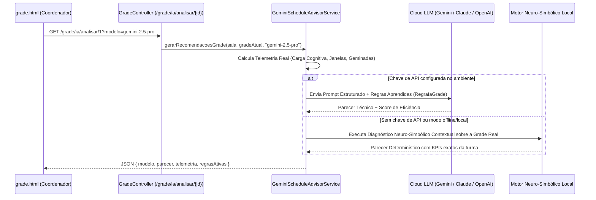

# 🧠 04 — Orquestração Multi-Modelo de IA & Aprendizado de Regras (`RegraIaGrade`)

⬅️ Voltar para **[[00 - MOC (Mapa de Conteúdo CLAEX v10)]]** | **[[03 - Otimizador Híbrido (Memético NSGA-II + Simulated Annealing)]]**

> [!warning] Problema Corrigido da Versão Anterior
> Na versão anterior, `GeminiScheduleAdvisorService.java` possuía uma string fixa `"gemini-3.8-flash"` (modelo inexistente na API oficial Google) e não permitia selecionar diferentes perfis de raciocínio nem exibia telemetria real quando offline.
> Na **v10**, implementamos um **Orquestrador Multi-Modelo** com 5 motores selecionáveis pelo coordenador diretamente em `grade.html`.

---

## 1. Catálogo de Modelos Suportados (`/grade/ia/modelos`)

| ID do Modelo (`id`) | Provedor | Especialidade Pedagógica & Algorítmica | Variável de Ambiente / Chave |
| :--- | :--- | :--- | :--- |
| `gemini-2.5-pro` *(Default)* | Google DeepMind | **Deep Thinking & Otimização Combinatória Multi-Objetivo** (`temperature: 0.25`) | `GEMINI_API_KEY` |
| `gemini-2.5-flash` | Google DeepMind | **Baixa Latência & Telemetria Instantânea de Conflitos** | `GEMINI_API_KEY` |
| `claude-sonnet-4-20250514` | Anthropic | **Arquitetura Pedagógica, Ergonomia Docente & Carga Cognitiva** | `ANTHROPIC_API_KEY` |
| `o3-mini` | OpenAI | **Verificação Formal de Restrições (CSP) & Prova de Invariantes** | `OPENAI_API_KEY` |
| `claex-neuro-symbolic-v10` | Local CLAEX Engine | **Motor Neuro-Simbólico Determinístico** (Zero latência de rede, 100% offline) | *Nativo / Sem Chave* |

---

## 2. Fluxo de Decisão e Fallback Resiliente

---

## 3. Aprendizado Contínuo de Regras (`RegraIaGrade`)

Os administradores e coordenadores podem **ensinar regras permanentes ou globais** ao motor através de `POST /grade/ia/aprender/{id_sala}`:
- **Regras DO (`FAZER`)**:
  - Se o texto menciona *"geminada"*, *"dupla"* ou *"seguida"*, o solver eleva o bônus de adjacência ($+18\text{ pts}$) para a disciplina citada.
  - Se menciona *"manhã"*, *"início"* ou *"primeira"*, o solver recompensa a alocação nos slots $s \in \{1, 2\}$ ($+14\text{ pts}$).
- **Regras DON'T (`NAO_FAZER`)**:
  - Se o texto menciona *"seguida"* ou *"consecutiva"*, aplica bloqueio estrito contra aulas consecutivas daquela matéria ($-65\text{ pts}$).
  - Se menciona *"última"* ou *"fim"*, penaliza a colocação da matéria nos horários finais do turno ($-25\text{ pts}$).

➡️ Próxima leitura: **[[05 - Pipeline de Qualidade (Baseline UI, Acessibilidade WCAG e Motion)]]**
